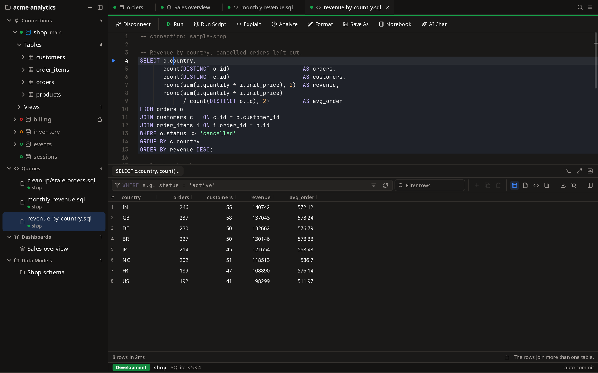
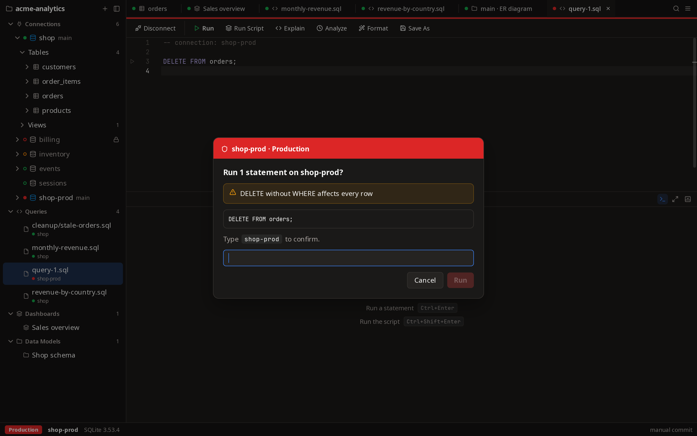
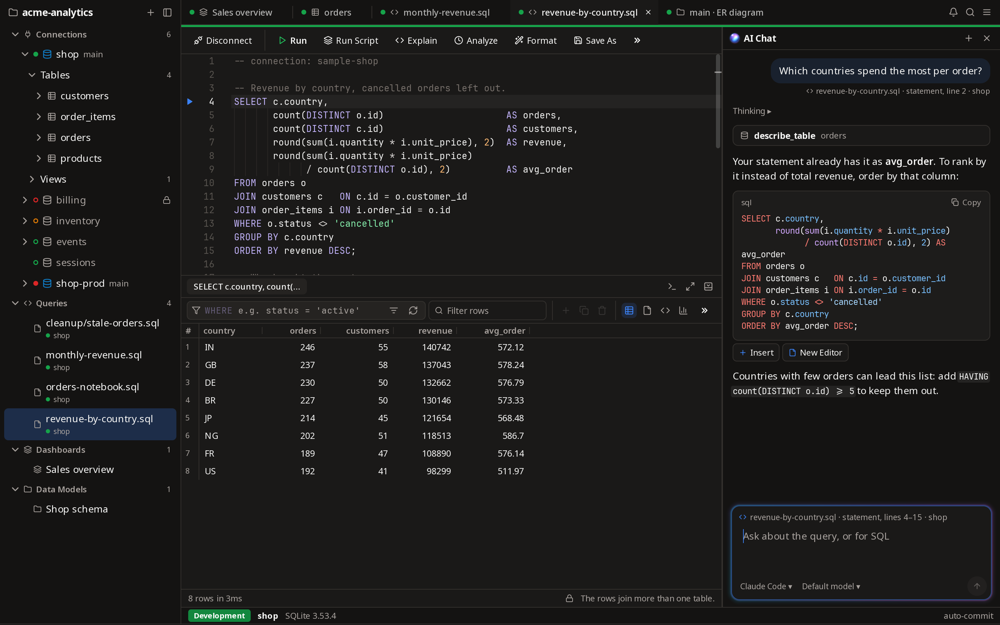
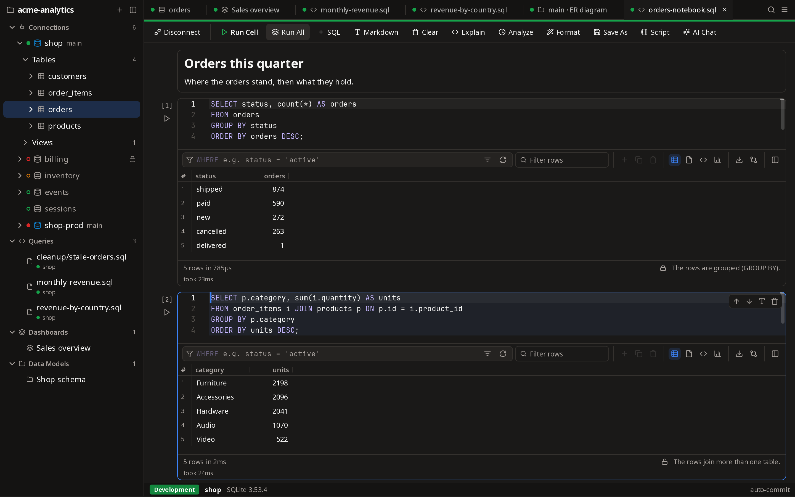
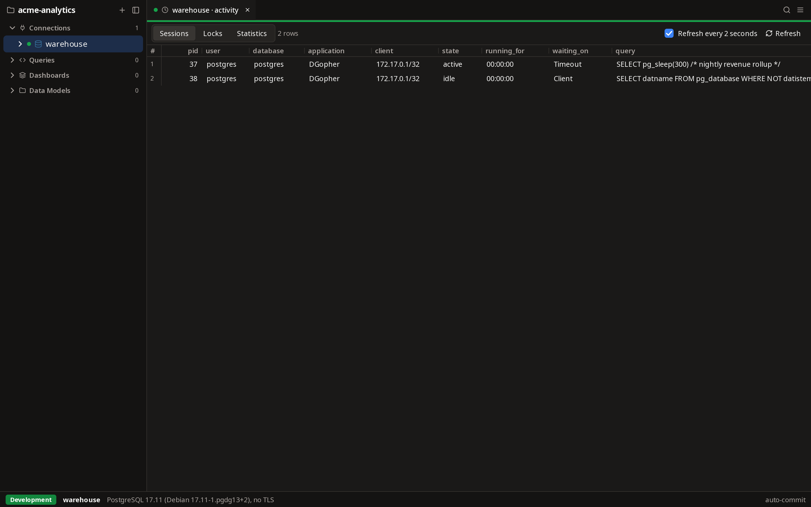
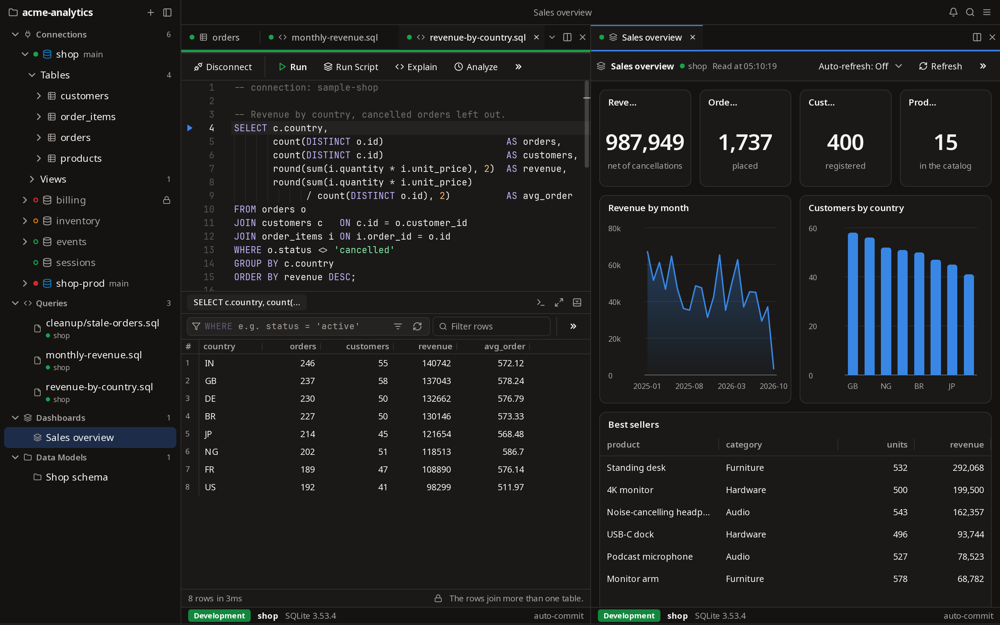

# DGopher

**Dig into your databases.** DGopher is a fast, free and open-source
database client for Linux, macOS and Windows. One app for **PostgreSQL,
MySQL, SQL Server, Oracle, ClickHouse, SQLite, DuckDB and Redis**, and for
CockroachDB, YugabyteDB, TimescaleDB, MariaDB and TiDB as engines of their
own.

[Download](https://github.com/saanuregh/dgopher/releases/latest) ·
[Features](docs/features.md) · [Engine support](docs/engines.md) ·
[Documentation](docs/README.md)

<picture>
  <source media="(prefers-color-scheme: light)" srcset="docs/images/main-light.png">
  
</picture>

## Why DGopher

- **Native and light.** One Go binary, drawn by
  [MyGo](https://mygo.egoist.dev), with no webview, JVM or Electron. It
  starts instantly and looks the same on every system. See
  [Footprint](#footprint).
- **Hard to break production.** Mark a connection as production and its
  color shows everywhere. Writes ask first, a destructive statement needs the
  connection's name typed, transactions commit only when you say, and an
  open transaction is never closed silently. See the
  [Safety model](docs/safety.md).
- **AI that works with your query.** Ask Claude Code, Codex or pi beside
  any editor. It runs the `claude`, `codex` or `pi` command line you have
  installed, so it uses your existing subscription and its models, with no
  API key to give DGopher. It sees your statement and its last error, reads the
  schema, and writes SQL you insert with a click. It runs a query on its
  own only after you allow it, only reads, never on production, and has
  no access to your files or shell.
- **SQL, Redis and files in one app.** Query SQL databases, browse and
  edit Redis on one server, a cluster or through Sentinel, and drop a CSV,
  Parquet or JSON file on the window to query it with DuckDB.
- **Made for teams.** Connections, query files, dashboards, data models and
  snippets live in your Git repository, without passwords. Every statement
  and edit goes into a tamper-evident [audit log](docs/audit-log.md).
- **Each engine as itself.** Plans, catalog, server activity and backup
  follow each engine's own tools, from PostgreSQL's `EXPLAIN ANALYZE` to
  Oracle's PL/SQL and Data Pump, SQL Server's T-SQL batches and
  TimescaleDB's hypertables. See [Engine support](docs/engines.md).

DGopher is young and has not reached 1.0. [Known limitations](docs/limitations.md)
lists what it does not do yet, and the [Roadmap](docs/roadmap.md) what is
planned.

## Screenshots

| | |
| --- | --- |
|  |  |
|  |  |
|  |  |
|  |  |
|  |  |
|  |  |

## Install

Download the build for your system from the
[latest release](https://github.com/saanuregh/dgopher/releases/latest):

| System | Builds |
| --- | --- |
| Linux | amd64, arm64 (`.deb` and `.tar.gz`) |
| macOS | Apple silicon, Intel (disk image) |
| Windows | amd64 (installer) |

The builds are not signed for macOS or Windows yet. On macOS, allow the
app once in System Settings → Privacy & Security. On Windows, SmartScreen
warns once.

The app checks for updates once a day and offers to install them, or
choose **Check for Updates…** in the menu. The `.deb` is updated by
installing the new one instead.

To build from source, see [Development](docs/development.md).

## Quick start

1. Open DGopher and choose **Try the sample** on the start page. It creates
   a small shop database in SQLite, so you need no server.
2. Take the one-minute tour the start page offers.
3. Press ⇧⌘P (Ctrl+Shift+P on Linux and Windows) for the command palette, or ⌘N
   for a new connection. You can paste a connection URL such as
   `postgres://user@host/db` into the form, or choose Neon or Supabase.

## Features

### Query

- **Editor:** completion from the catalog, a ▶ on every statement,
  problems underlined as you type, hover cards that say what a name is, Go
  to Definition, Find Usages and Rename, `:name` parameters, multiple
  carets, Vim keys, and a session per editor.
- **Results grid:** streams large results, chooses blocks of cells as a
  spreadsheet does, filters in SQL or with a builder, sorts, follows
  foreign keys both ways, compares two results row by row, profiles every
  column, and opens values in JSON, XML, hex and image viewers.
- **Edit rows safely:** edits in the grid are shown as SQL to review, then
  applied in one transaction, one row per statement by primary key.
- **Query plans:** Explain and Explain Analyze as a tree of steps or a
  flame graph, with rows estimated and found, and advice on what makes a
  query slow.
- **Charts and dashboards:** chart any result, and put any read query on a
  dashboard as a number, a chart or a table, with parameters and refresh.
- **Notebooks:** show any SQL file as cells, Jupyter-style, each with its
  own results, with Markdown between them. The file stays SQL that runs as
  a script.

### Data and schemas

- **Files:** import CSV, JSON, Parquet, Excel and XML. Export to CSV, JSON,
  SQL, Markdown, Excel, Parquet and more.
- **Move data:** copy tables between databases and engines, compare rows,
  generate test data, back up and restore, and run SQL dumps of any size,
  checked before they run.
- **Schema:** ER diagrams you can edit, a table designer, data models that
  generate migrations, a query builder, search across objects and their
  definitions, and documentation of a schema as HTML or Markdown.
- **Admin:** server activity with running queries to cancel, locks and the
  slowest statements; users and privileges; and VACUUM, ANALYZE, REINDEX
  or OPTIMIZE from a table's menu.
- **Redis:** a key browser, value editors for every type including Redis
  8's, a console with completion, and monitor, slow log, memory and
  Pub/Sub panels.

### Connections and security

- Passwords stay in the system keychain or a `DGOPHER_*` environment
  variable, come from a command such as a password manager, or are asked
  every time. Secrets are redacted from history and logs.
- Log in without a password through AWS IAM, Google Cloud IAM or Microsoft
  Entra ID, or Kerberos on PostgreSQL and SQL Server.
- TLS with a custom CA and client certificates, SSH tunnels through jump
  hosts with host keys checked, and SOCKS5 or HTTP proxies.
- Read-only connections are enforced in the app and on the server (on
  TiDB, which refuses the server's setting, by the app alone).
- Columns such as `password`, `token` or `card_number` show `••••••`, and
  a connection can keep its rows from the AI chat.

### Everyday comfort

- **Keyboard first:** a command palette, quick open for tables and query
  files, and keys like Zed's, every one of which can be changed.
- **History and snippets:** every statement run, with its timing and
  error, a key away; snippets with fields filled in by Tab.
- **Tabs and groups:** pin, reorder and reopen tabs, split them side by
  side, drag one into another window, and get them back after a restart.
- **Errors that help:** an error says what most likely went wrong and
  offers the fix, such as Retry or Edit Connection.
- **Your way:** light, dark and custom themes, zoom, and every control
  named for screen readers.

[Features](docs/features.md) describes everything DGopher does.

## Footprint

Measured on Linux (amd64, Wayland) with version 0.7.0, at the start page:

| | |
| --- | --- |
| Download | 45 MB, as the `.deb` or the `.tar.gz` |
| Executable | 131 MB, with every driver and DuckDB compiled in |
| Memory at start | about 180 MB resident, of which about 55 MB is the app's own; the rest is the executable and the GTK and graphics libraries, mapped from disk |

## Documentation

The [documentation index](docs/README.md) lists every page:

- [Features](docs/features.md), [Engine support](docs/engines.md) and
  [Keyboard shortcuts](docs/keyboard.md)
- [Safety model](docs/safety.md) and [Audit log](docs/audit-log.md)
- [Where things are kept](docs/storage.md) and [Project files](docs/project-files.md)
- [Command line](docs/command-line.md) and [Troubleshooting](docs/troubleshooting.md)
- [Known limitations](docs/limitations.md) and [Roadmap](docs/roadmap.md)
- For contributors: [Development](docs/development.md),
  [Architecture](docs/architecture.md), [Testing](docs/testing.md),
  [How SQL is read](docs/sql.md) and [CONTRIBUTING.md](CONTRIBUTING.md)

## AI disclosure

Most of DGopher's code and documentation is written with AI coding
agents, such as Claude Code and Codex. The maintainer directs, reviews and
tests every change.

## Contributing and security

See [CONTRIBUTING.md](CONTRIBUTING.md). Report vulnerabilities privately,
as [SECURITY.md](SECURITY.md) describes. Each version's changes are in its
[release notes](https://github.com/saanuregh/dgopher/releases).

## License

Copyright 2026 DGopher contributors. Licensed under the
[Apache License, Version 2.0](LICENSE).

The icon is based on the Go gopher, designed by Renée French and licensed
under [CC BY 4.0](https://creativecommons.org/licenses/by/4.0/).
