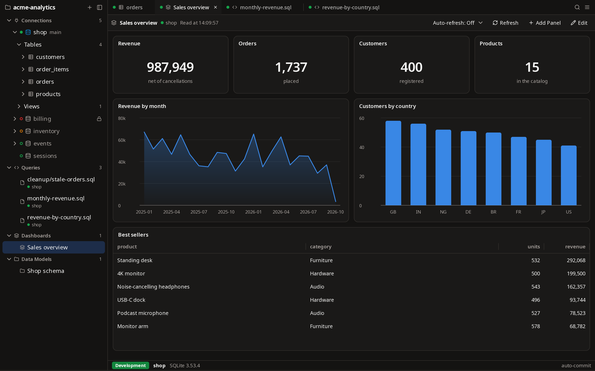
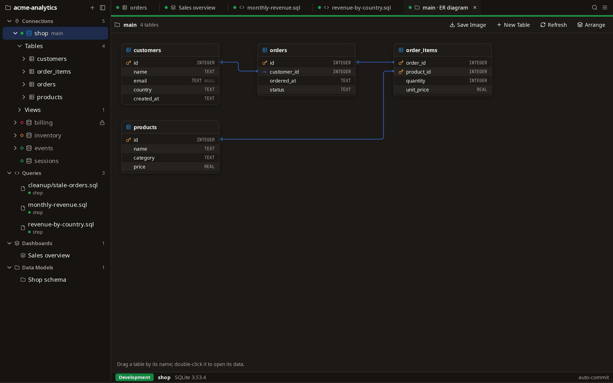
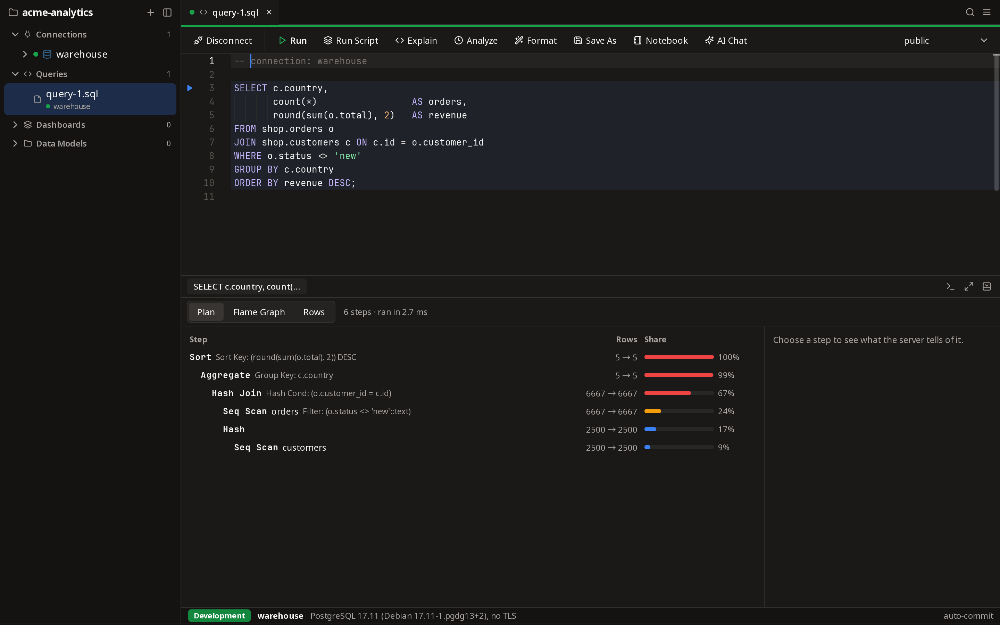
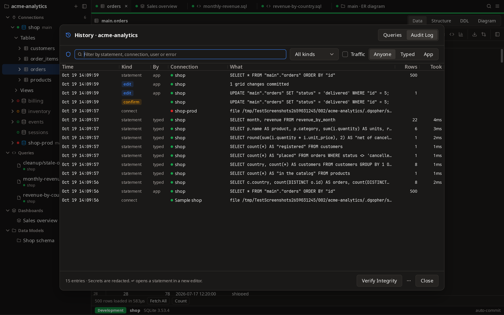
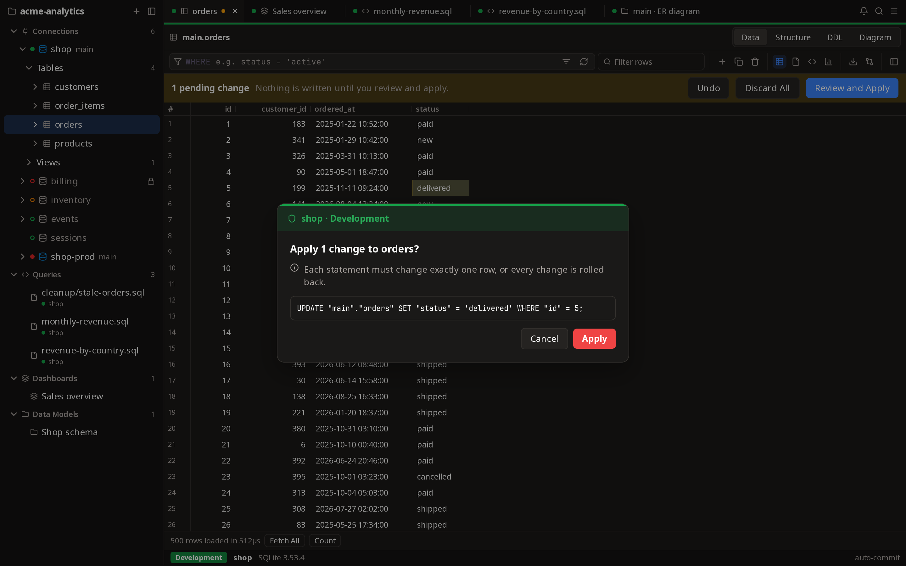
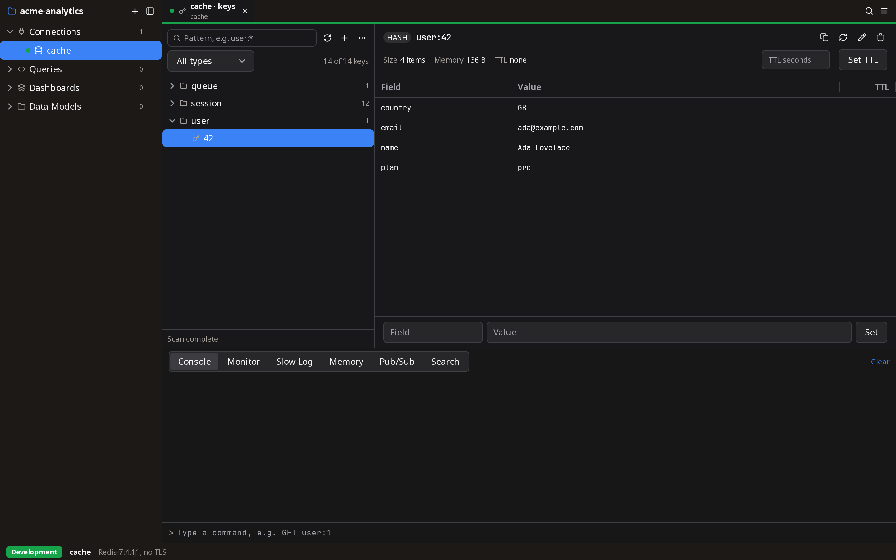

# DGopher

**Dig into your databases.** DGopher is a fast, open-source database client
for Linux, macOS and Windows. It works with **PostgreSQL, MySQL,
ClickHouse, SQLite, DuckDB and Redis**.

It is a single Go binary. Its interface is drawn natively by
[MyGo](https://mygo.egoist.dev), with no webview, JVM or Electron. It
starts instantly, looks the same on every system, and is careful by default
with the databases that matter.

## Install

Download the build for your system from the
[latest release](https://github.com/saanuregh/dgopher/releases/latest):

| System | Builds |
| --- | --- |
| Linux | amd64, arm64 (`.deb` and `.tar.gz`) |
| macOS | Apple silicon, Intel (disk image) |
| Windows | amd64 (installer) |

The builds are not signed yet. On macOS, allow the app once in System
Settings → Privacy & Security. On Windows, SmartScreen warns once.

To build from source, see [Development](docs/development.md).

## Quick start

1. Open DGopher and choose **Try the sample** on the start page. It creates
   a small shop database in SQLite, so you need no server.
2. Take the one-minute tour the start page offers.
3. Press ⌘K (Ctrl+K on Linux and Windows) for the command palette, or ⌘N
   for a new connection. You can paste a connection URL such as
   `postgres://user@host/db` into the form.

## Highlights

### Safe with production

- Each connection has an environment (development, staging or production),
  and its color shows everywhere.
- On production, writes ask first, destructive statements need the
  connection's name typed, and manual commit is the default.
- Read-only connections are enforced both in the app and on the server.
- An open transaction is never closed silently. One left idle rolls back,
  after a warning.
- Grid edits are shown as SQL to review, then applied in one transaction,
  one row per statement by primary key.

See the [Safety model](docs/safety.md).

### Secure and auditable

- Passwords stay in the system keychain or a `DGOPHER_*` environment
  variable, come from a command such as a password manager, or are asked
  every time. Project files hold none, and secrets are redacted from
  history and logs.
- Log in without a password through AWS IAM, Google Cloud IAM or Microsoft
  Entra ID, or Kerberos on PostgreSQL.
- TLS with a custom CA and client certificates, SSH tunnels through jump
  hosts with host keys checked, and SOCKS5 or HTTP proxies.
- Every statement, edit, import, export and confirmation is recorded per
  project in a tamper-evident [audit log](docs/audit-log.md) that you can
  verify and export.

### Work with SQL

- **Editor:** highlighting, completion from the catalog, a ▶ on every
  statement, `:name` parameters, folding, multiple carets, Vim keys, find
  and replace, Go to Definition, problems underlined as you type, and a
  session per editor.
- **Results grid:** streams large results, chooses blocks of cells as a
  spreadsheet does, filters (in SQL or with a builder), sorts, edits rows
  inline, follows foreign keys both ways,
  profiles every column, and opens values in JSON, XML, hex and image
  viewers.
- **Query plans:** Explain and Explain Analyze as a tree of steps or a
  flame graph, with rows estimated and found, and advice on what makes a
  query slow.
- **Charts and dashboards:** chart any result, and put any read query on a
  dashboard as a number, a chart or a table, with parameters and refresh.

### Work with data and schemas

- **Files:** drop a CSV, Parquet or JSON file on the window to query it in
  place with DuckDB. Import CSV, JSON, Parquet, Excel and XML. Export to
  CSV, JSON, SQL, Markdown, Excel, Parquet and more.
- **Move data:** copy tables between databases and engines, compare rows,
  generate test data, back up and restore.
- **Schema:** ER diagrams you can edit, a table designer, data models that
  generate migrations, a query builder, and search across objects and their
  definitions.
- **Admin:** server activity with running queries to cancel, locks and the
  slowest statements; users and privileges; and VACUUM, ANALYZE, REINDEX
  or OPTIMIZE from a table's menu.
- **Redis:** a key browser, value editors for every type including Redis 8's,
  a console with completion, and monitor, slow log, memory and Pub/Sub
  panels. One server, a cluster, or through Sentinel.

### Built for daily use

- **Git-friendly projects:** connections, query files, snippets,
  dashboards and data models live in your repository, without secrets.
- **Keyboard first:** a command palette, quick open for tables and query
  files, and every shortcut customizable.
- **Tabs that stay:** pin, reorder and reopen tabs, open two side by side or
  in another window, and get them back after a restart.
- **Your way:** light, dark and custom themes, and every control named for
  screen readers.

See [Features](docs/features.md) for everything DGopher does.

| | |
| --- | --- |
|  |  |
|  |  |
|  |  |

## Footprint

Measured on Linux (amd64, Wayland) with version 0.1.0:

| | |
| --- | --- |
| Download | 36 MB, as the `.deb` or the `.tar.gz` |
| Executable | 99 MB, with every driver and DuckDB compiled in |
| Memory at start | 164 MB resident, of which 36 MB is the app's own; the rest is the executable and the GTK and graphics libraries, mapped from disk |

## Documentation

The [documentation index](docs/README.md) lists every page:

- [Features](docs/features.md), [Engine support](docs/engines.md) and
  [Keyboard shortcuts](docs/keyboard.md)
- [Safety model](docs/safety.md) and [Audit log](docs/audit-log.md)
- [Where things are kept](docs/storage.md) and [Project files](docs/project-files.md)
- [Command line](docs/command-line.md) and [Troubleshooting](docs/troubleshooting.md)
- [Known limitations](docs/limitations.md) and [Roadmap](docs/roadmap.md)
- For contributors: [Development](docs/development.md),
  [Architecture](docs/architecture.md), [Testing](docs/testing.md),
  [How SQL is read](docs/sql.md) and [CONTRIBUTING.md](CONTRIBUTING.md)

## Contributing and security

See [CONTRIBUTING.md](CONTRIBUTING.md). Report vulnerabilities privately,
as [SECURITY.md](SECURITY.md) describes. Each version's changes are in its
[release notes](https://github.com/saanuregh/dgopher/releases).

## License

Copyright 2026 DGopher contributors. Licensed under the
[Apache License, Version 2.0](LICENSE).

The icon is based on the Go gopher, designed by Renée French and licensed
under [CC BY 4.0](https://creativecommons.org/licenses/by/4.0/).
