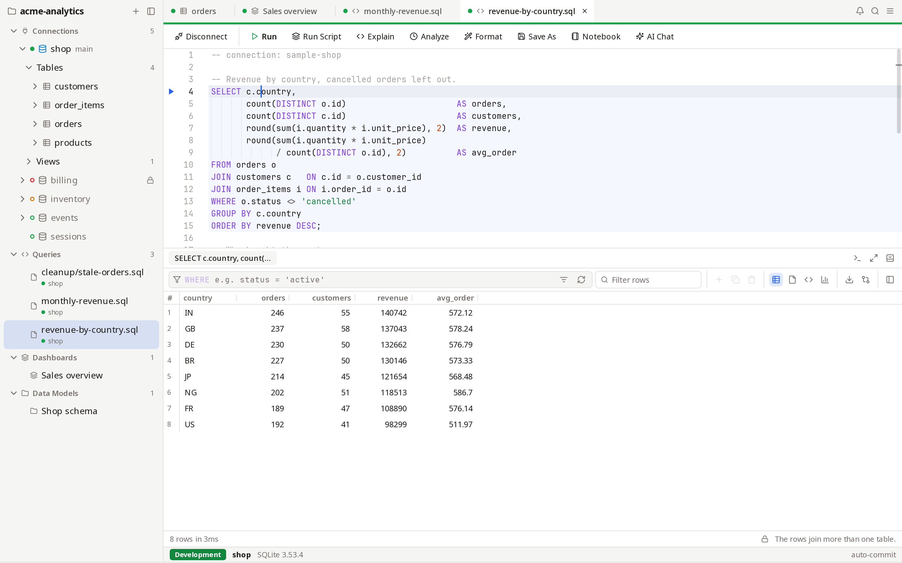

# Features

Everything DGopher does, by area. Keys are written as on macOS; on Linux
and Windows, ⌘ is Ctrl and ⌥ is Alt. [Keyboard shortcuts](keyboard.md)
lists the default keys.

- [Getting started](#getting-started)
- [The window](#the-window)
- [Projects](#projects)
- [Connections](#connections)
- [The navigator](#the-navigator)
- [SQL editor](#sql-editor)
- [Results grid](#results-grid)
- [Table tabs](#table-tabs)
- [Export](#export)
- [Charts](#charts)
- [Dashboards](#dashboards)
- [Schema tools](#schema-tools)
- [Moving data](#moving-data)
- [Server administration](#server-administration)
- [Redis](#redis)
- [History and snippets](#history-and-snippets)
- [Settings and themes](#settings-and-themes)
- [Accessibility](#accessibility)

## Getting started

- **Try the sample.** The start page offers a small shop database in
  SQLite, made on your computer, so you can explore without a server.
- **The tour.** A short guided tour explains projects and connections,
  editors and results, the palette, how production connections are
  guarded, and the sample database. It highlights the part of the window
  each step is about. The start page offers it until you take it; the
  Help menu and the palette always do.
- **Paste a connection URL** into the connection form to fill it in. See
  [Connection URLs](#connection-urls).
- **Drag and drop** a file onto the window:

  | File | What happens |
  | --- | --- |
  | SQLite (`.sqlite`, `.sqlite3`, `.db`, `.db3`) or DuckDB (`.duckdb`, `.ddb`) | opens as a connection |
  | `.sql` | opens in an editor on the connection chosen in the navigator |
  | CSV, TSV, Parquet, JSON or JSON Lines (`.csv`, `.tsv`, `.parquet`, `.json`, `.jsonl`, `.ndjson`) | queried in place with DuckDB |
  | Excel (`.xlsx`) or XML | imported into a new table of the connection chosen in the navigator |

- **Open Recent** in the File menu (and the Dock, the jump list on Windows,
  and recent files on Linux) lists the last SQL, SQLite and DuckDB files
  opened, which open as a dropped file does.
- **Offline.** While the computer is offline, the bar of an unconnected
  editor says so. Redis subscriptions and MONITOR that stopped start again
  once it is back online; nothing else runs again by itself.

## The window

### Title bar and menus

The title bar looks the same on every system and sits beside the system's
window buttons, without a row of its own:

- The sidebar's top row adds a project or a connection, and hides the
  sidebar.
- The tab row shows the sidebar again, and holds the palette's search box
  and the app menu: File, View, Help, Settings and Quit.
- Both rows drag the window. On macOS the system menu bar is kept too.

### Command palette

- **⌘K** opens the palette: every command, connection, table, dashboard,
  data model and snippet, by name. The current tab's commands come first,
  such as running, explaining, formatting, committing or rolling back in an
  editor, or refreshing, exporting, fetching, charting and applying rows.
  Each command shows its key.
- **⌘P** opens a table, view, function, procedure or query file by name.

### Tabs

- **Where a tab runs.** Each tab shows its connection: a dot per
  connection in its color (up to three, then a count), filled while
  connected, a ring while not, and a warning when one failed. Under the
  title it shows the connection, and the database when it is not the
  connection's own. The tooltip lists every connection and its state.
- **Reorder** by dragging a tab along the bar. The middle button closes it.
- **Pin** a tab from its menu. A pinned tab moves to the front and shows a
  pin instead of its close button (click the pin to unpin). Close Others,
  Close to the Right, Close All, ⌘W and the middle button leave it open;
  only its menu's Close closes it. Pins survive a restart.
- **Close several** with Close Others, Close to the Right or Close All. The
  app asks once about everything they would lose, with Commit for open
  transactions.
- **Reopen Closed Tab** (⇧⌘T) reopens the last closed tabs, newest first, up
  to 20: editors by their file, tables at their page, diagrams, dashboards
  and models. A tab whose file or connection is gone says so.
- **Overflow.** Tabs that do not fit are listed by a button at the end of
  the bar.
- **Side by side.** Open to the Side, in a tab's menu, shows the tab beside
  the one in front, with a divider to drag. Keys go to the tab marked as in
  front; clicking into the other brings it in front.

### Status bar

- It shows the connection of the tab in front, with its database, and its
  environment in the environment's own color.
- For a tab on several connections, such as a dashboard, it shows a chip
  per connection, problems first, up to three and then "+N more". Each chip
  lists its databases (and the dashboard's panels on them) and connects,
  retries or disconnects its connection.
- It lists every open transaction and how long it has been open.
- **Activity.** Once any work (a query, reading rows, a count, an export,
  connecting…) has lasted 300 ms, a thin bar moves along the top of the
  status bar. Quick work shows nothing. Long work offers Stop or Cancel
  where it runs: Fetch All, Count and applying grid changes in the data
  view, and connecting in the status bar, the navigator's menu and a
  restored tab. A cancelled connect is audited, and one that finishes late
  is closed.

### More windows

- A tab's **Move to New Window** puts it in a window of its own, titled by
  its tab in front, beside the main window's sidebar.
- Tabs move between windows. Opening a tab that is already open brings it
  forward in its window.
- Dialogs show in the window you are using.
- Closing a window moves its tabs back to the main window, so nothing in
  them is lost, such as an open transaction. The workspace reopens them all
  there.
- Closing the last tab leaves the start page.
- On macOS, closing the window keeps DGopher running with its tabs and
  connections; the Dock icon shows it again.

### Restart

The tabs come back in their order, with the same one in front: editors,
dashboards and models, and a connection's tables at their page, ER
diagrams, Redis keys, activity, users and search tabs.

- A connection's tab waits, unconnected, until its connection connects: on
  its own when it comes into view if the connection auto-connects, or when
  you press Connect or ↵.
- Opening the same table meanwhile takes the waiting tab's place.
- Filters and sort start afresh.
- The window's size and position are restored.

### Notifications

A statement, script, export or import that took 10 seconds or more tells
the system when it ends, if DGopher is in the background. The notice says
what ran, on which connection, and its first error, but never its SQL.
Clicking it brings its tab forward. The time is a setting (0 turns
notifications off).

## Projects

Every connection belongs to a project: a folder, such as a repository.
The sidebar lists every project with its connections, query files,
dashboards and data models. [Where things are kept](storage.md) lists the
files.

- **Create** one with **New Project…**, or add an existing folder with
  **Add Existing Folder…** or `dgopher <folder>`.
- **Share with your team.** `dgopher.json` holds the project's connections
  (with their environments) and snippets, and no secrets. It is written
  sorted and stable, so it diffs cleanly.
- **Never overwritten.** A file changed on disk, as by a `git pull`, is
  never overwritten. Reload the project from its menu.

### Query files

- Every SQL editor is a file in `queries/`, saved as you type. Its tab
  shows a dot until the file holds what you typed.
- A `-- connection: <id>` line binds a file to a connection. Connection IDs
  complete as you type the line.
- A file runs only on the connection its line names. An editor whose file
  names another connection runs nothing and offers to switch to it. A file
  naming a connection the project lacks opens unconnected, so you can fix
  its line. A restored editor follows its file's line, as after a pull that
  changed it.
- A file changed on disk while open reloads at once when the editor holds
  no unsaved text; otherwise it is never overwritten, and the editor offers
  **Reload** or **Keep Mine**. A file deleted on disk is marked so.
- The sidebar's list of query files follows the folder as files come and go.
- An editor closed without typing anything removes its file.
- **Duplicate** (in an editor tab's menu, a query file's menu, or the
  palette) opens a copy of the editor, including unsaved edits, in a new
  query file on the same connection.
- Query files, dashboards and data models are renamed (F2) or deleted
  (Delete) from their menu in the sidebar; an open tab follows. A
  dashboard's or a model's file is named after it.

### Connection IDs

A connection's ID changes in its form, once you agree to what that
rewrites:

- `dgopher.json` and its tables' settings;
- the query files, dashboards and data models that name it;
- open editors, keeping their unsaved text;
- its saved password and trust, which move with it.

Query history and the audit log keep the old ID. Teammates who pull the
change are asked again whether to trust the connection, and for its
password. The button beside the ID makes a new one from the name, numbered
when another connection in the project has it.

## Connections

### Engines

| Engine | Notes |
| --- | --- |
| PostgreSQL | browse its other databases from one connection |
| MySQL and MariaDB | |
| ClickHouse | native protocol, or HTTP on 8123 and 8443 |
| SQLite | a file, or in memory; **New…** creates an empty file |
| DuckDB | a file, or in memory; **New…** creates an empty file |
| Redis | one server, a cluster, or the master Sentinel names |

**New…** never replaces a file that is already there; it opens it as it
is.

### The connection form

- **General** holds what most connections need: where the database is, who
  connects and where the password comes from, the environment, a color, and
  read-only.
- **Options** holds auto-connect, the commit mode, the idle-transaction and
  idle-connection limits, and the statement timeout.
- **Network** holds TLS, the proxy and SSH. It is marked when SSH, a proxy
  or a client certificate is set.
- **Test Connection** reports the server's version and how long connecting
  took.
- **Auto-connect** (off by default) opens the connection when DGopher
  starts, and connects its editors as they come into view.

### Environments and colors

Each connection has an environment: development, staging or production.
It decides what asks before running; see [Safety model](safety.md).

- A connection to another machine saves only once you choose its
  environment, Development included, and again when an edit points it at
  another machine. This is because the default, Development, asks nothing
  before a write. Local servers and files keep the default. Connections in
  the project file keep the environment they say.
- A connection's own color replaces its environment's in the navigator, its
  tabs and the band above its work. On staging and production, the band and
  the questions before a write keep the environment's color, so a color
  from a shared project cannot make production look safe.

### Connection URLs

Paste a URL, or a file path, into **From URL** to fill in the form,
including TLS.

- Schemes: `postgres://`, `postgresql://`, `mysql://`, `mariadb://`,
  `clickhouse://`, `ch://`, `redis://`, `rediss://`, `sqlite://`,
  `sqlite3://`, `duckdb://` and `file://`.
- TLS is read as each driver reads it:
  - PostgreSQL's `sslmode`: `verify-ca` and `verify-full` become
    verify-full.
  - MySQL's `ssl-mode` or `tls`: `tls=true` becomes verify-full.
  - ClickHouse's `secure` and `rediss://` become verify-full, or require
    (encrypted, not verified) with `skip_verify`.
  - `ssl=true` or `ssl=false` on PostgreSQL and MySQL become require or
    disable.
- An unknown value, two values that disagree, or a `tls_server_name` is
  shown as an error rather than quietly taken as prefer. (The app checks
  the certificate against the URL's host.)

### Passwords

The password comes from the system keychain, a `DGOPHER_*` environment
variable, a command such as a password manager, a cloud identity, or is
asked every time. [Secrets](safety.md#secrets) explains each.

### TLS

- Modes: off, prefer, require, or verify (the certificate and the host
  name), with a custom CA file.
- A client certificate logs in where the server asks for one.
- Prefer uses TLS when the server offers it, and connects without TLS when
  it does not.
- Prefer and require encrypt but do not check who the server is. So on
  PostgreSQL, under either mode, a server that asks for the password in
  clear text is refused. See [Secrets](safety.md#rules-for-each-protocol).
- Whether TLS was used shows after the server's version ("TLS" or "no
  TLS"), and in the connect's audit entry.
- ClickHouse over HTTP ignores `HTTP_PROXY` and refuses redirects to
  another host, so its password stays with the server.

### SSH tunnels

- Log in with the SSH agent, a key file with a passphrase, or a password.
  The passphrase or password can come from the keychain or a command.
- Jump hosts work as `ssh -J` does. A jump host logs in with the key file
  or the agent; the password goes only to the final SSH host. So a tunnel
  through jump hosts needs a key or the agent.
- Host keys are checked against `known_hosts`, including each jump host's.
  A new host must be trusted explicitly after you compare its fingerprint.
  A changed host key is refused as a possible attack.

### Proxies

SOCKS5 or HTTP CONNECT, to the server or to the SSH host, with a user and
a password kept in the keychain.

### Cloud identities and Kerberos

- **Cloud IAM.** PostgreSQL and MySQL can log in with an AWS IAM, Google
  Cloud IAM or Microsoft Entra ID token instead of a password. The cloud's
  own tool (`aws`, `gcloud`, `az`) prints the token after its single
  sign-on. The app makes a new one for new connections as it ages, and
  sends it only over verified TLS: verify-full, with the server's CA file
  unless the system trusts it (AWS's RDS CA bundle, Cloud SQL's server CA).
  AWS takes a region and a profile.
- **LDAP and PAM.** MySQL can send the password as clear text, over verified
  TLS only, as LDAP and PAM logins need. PostgreSQL's LDAP and PAM logins
  take the password as usual, under require or verify-full.
- **Kerberos.** A PostgreSQL server that asks for it gets the ticket from
  your `kinit`, from the credentials cache that `KRB5CCNAME` names, as
  `krb5.conf` (or `KRB5_CONFIG`) sets up. On Windows it uses your login's
  credentials.

### Redis topologies

- **Cluster.** Connect through any node. The key browser scans every
  master, and the console reaches a key on whichever node holds it.
- **Sentinel.** The connection follows the master to its replacement after
  a failover. It logs in to the sentinels with their own user and password,
  kept in the keychain.
- **SSH.** Through a tunnel, every node is reached through the SSH server.
- The form also sets the key separator for the key tree, and the database
  index.

## The navigator

Each project shows in sections: Connections (open at first), Queries,
Dashboards and Data Models. Each shows a count and, when pointed at, a +
that makes another. With only one project, its name is in the sidebar's
top row and its sections at the top.

- A query file shows, under its name, the connection its
  `-- connection:` line names, in its environment's color, or in the
  warning color if no connection has that ID.
- A connection is a tree of databases, schemas, tables, views and columns,
  read as you open it, with row estimates. A database with one schema shows
  that schema's folders directly.
- The navigator follows the tab in front, selecting its query file, table,
  dashboard, data model or connection, and opening what holds it.

### Schema objects

A schema's other objects are in folders by kind. Opening one shows its
definition in an editor, where you can change and run it.

The folders are functions and procedures, triggers, sequences and types,
where the engine has them, plus extensions (PostgreSQL), events (MySQL),
macros (DuckDB) and projections (ClickHouse).

A PostgreSQL partitioned table lists its partitions with their bounds.
Open a partition's rows, detach it, or make a new one, its statement
written for the table's partitioning strategy.

### Read Catalog

For very large schemas, **Read Catalog** on a schema sets how much the app
reads. The choice is kept in the project file.

| Choice | Reads |
| --- | --- |
| As Needed | tables with their sizes; a table's columns once it is opened or named in an editor |
| Names Only | no sizes, and columns only once a table is opened, never for completion or the editor's checks |
| Names and Columns | every column of the schema in one query, so completion needs no more |
| Everything | also routines, triggers, sequences and types |

### Menus

| Item | Menu offers |
| --- | --- |
| Empty sidebar | New Connection…, New Project…, Add Existing Folder… |
| Project | New Connection…, New SQL Editor (with a SQL connection), New Dashboard…, New Data Model…; Query History; Audit Log; Show in Files; Reload; Remove from Sidebar… |
| Connection | Connect or Disconnect (Cancel Connecting while it connects), Refresh, New SQL Editor, Run SQL File…, Search Objects…, Server Activity (servers only), Users and Privileges (where supported), Catalog Queries (SQL only), Back Up…, Restore… (not on read-only connections), a submenu for its schema, Edit Connection…, Duplicate, Delete Connection…; on Redis, Open Key Browser |
| Schema | New Table…, View ER Diagram, Import File as New Table…, Export Tables…, Copy Tables to Another Database…, Generate SQL Script…, Generate Documentation…, Save as Data Model…, Run SQL File…, Back Up…, Restore…, Search Objects…, Read Catalog, New SQL Editor, Refresh |
| Table or view | Open Data, View Structure, View DDL, New SQL: SELECT, Build a Query…, Copy Name, Rename…, Export Data…, Import Data…, Generate Test Data…, Drop…; tables also Copy to Another Database…, Compare Rows with…, Maintenance and Truncate…; partitioned tables also New Partition… |
| Partition | Open Data, Detach… |
| Column | Copy Name, Rename… (columns of tables) |
| Function, sequence, type, … | Open Definition, Copy Name |
| Query file, dashboard, data model | Rename…, Duplicate (query files), Delete… |

Keys in the navigator: ⌘↵ opens a `SELECT *` of the table in a new editor,
⌘R reads the schema again, ⌘C copies the table's name, F2 renames it, F4
shows its structure, and Delete opens a `DROP` of it in a new editor to
review and run. On a query file, dashboard or data model, Delete deletes
it.

**Catalog Queries**, on a connection's menu or in the palette, lists the
latest queries the app ran on its own to read the catalog (for the
navigator, completion and so on), with each one's time, arguments and
error.

## SQL editor

### Editing

- Syntax highlighting for each engine's dialect, and line numbers. Only the
  lines in view are drawn, so a long script scrolls and edits as fast as a
  short one.
- Brackets and quotes close as you type them, and wrap a selection. Enter
  keeps the indentation and continues a `--` comment.
- Move lines with ⌥↑ and ⌥↓, duplicate them with ⌥⇧↑ and ⌥⇧↓, and delete
  them with ⌘⇧K. ⌃G goes to a line.
- ⌘/ comments or uncomments the lines with `--`, and ⌘⌥/ puts the
  selection in a `/* … */` block comment or takes it out.
- **Several carets.** ⌘⌥↑ and ⌘⌥↓ add one on the line above or below;
  ⌥-click adds one where you click (and removes one you click on). ⌥⇧-drag
  makes a column selection. ⌘D selects the word at the caret, then its next
  whole occurrence; ⌘⇧L selects every one. What you type, delete or
  complete at one caret happens at each. The arrows, Home and End move them
  all; Esc goes back to one.
- **Folding.** A statement, a group in parentheses or a block comment over
  several lines folds to its first line and a ⋯. Use the gutter's markers,
  or ⌘⌥[ and ⌘⌥] at the caret (add ⇧ for every block). Folded text stays in
  the file, and runs.
- **Find and replace** (⌘F, ⌘⌥F): match case, whole words or a regular
  expression, in the selection or the whole text, one match at a time or
  all at once. ⌘Z undoes a Replace All.
- **Format** (⌘⇧F) formats the selection, or the whole text, keeping the
  blank lines between statements.
- **Right-click menu**: cut, copy, paste, comments, case, folding and
  selections; then run, format, copy the statement, save as a snippet, and
  export from the query.

### Finding your way

- **Problems are underlined as you type**: a string, quoted name or comment
  left open; a parenthesis that closes nothing or is not closed; and,
  against the catalog, a table or a column (`alias.column`) that does not
  exist. The line under the editor says what is wrong at the caret, with
  the closest existing name as a fix that ⌥↵ applies. Statements that
  create or drop tables are not checked for names.
- **Go to Definition** (F12, or ⌘-click) opens what the name at the caret
  refers to: a table's or view's structure (also through an alias or one of
  its columns), or a routine's definition.
- **Find Usages** (⇧F12) lists where the name is used in this file and the
  project's other query files.
- **Rename in File** (F2) renames the name everywhere in the file, quoting
  it where needed. (The navigator's Rename renames it in the database.)
- **Go to Statement** (⌘⇧O) lists the file's statements by line, with the
  comment above each, filtered as you type.

### Completion

- Completes tables, columns (aware of aliases), schemas, keywords, the
  engine's common functions and the schema's own functions (with their
  parentheses), and snippets by their keyword.
- The list opens as you type, or with ⌃Space. It narrows as you type, best
  match first, matching the letters in order (`usr` finds `users`). ↵ or
  Tab inserts the chosen item.
- A table completed after `FROM` or `JOIN` gets a short alias from its
  words' first letters (`reflex_order ro`), kept apart from the statement's
  other aliases and from keywords (`ro2`).

### Running statements

- **Statements end** at `;` or at a blank line, so ⌘↵ runs the statement
  around the caret without selecting it; a band shows which statement. A
  setting makes `;` the only end. A procedure, function or trigger body
  (`BEGIN … END`, `BEGIN ATOMIC`) stays one statement, and MySQL
  `DELIMITER` lines work as in the `mysql` client.
  [How SQL is read](sql.md#splitting-a-script) has the details.
- **Run** the statement (⌘↵ or F5), the selection, or the whole script (⌘⇧↵
  or ⌥X). `⌘\` runs into a new result tab, keeping the others. Result tabs
  can be pinned.
- **A ▶ in the gutter**, on the first line of each statement, runs that
  statement.
- **On an error,** a script stops or continues, as a setting says. A failed
  statement shows the database's message, code, detail, hint, and where it
  went wrong; **Go to Error** puts the caret there.
- **Statement timeout**: optional, per connection.
- **Each editor has its own session**, so `SET`, temporary tables and
  transactions last between statements.
- **Commit and roll back** from the editor's bar in manual commit, or with
  ⌘⌥⇧↵ to commit. Roll back has no key unless you set one, because it loses
  the transaction's work.
- **Schema and database.** The editor's toolbar shows the schema it looks
  up names in (and on PostgreSQL its database), and switches them. A schema
  switch runs `SET search_path` or `USE` on its session, and is audited. A
  database switch uses a new session, and never happens with a transaction
  open. Typing a `SET` or `USE` moves the toolbar too.

### Parameters

- `:name` parameters (also `@name` and `$name` on SQLite), ClickHouse
  `{name:Type}` parameters and `${var}` variables take their values from
  the **Parameters bar** above the editor, which lists those in the text.
- A run asks only for values left empty there.
- Values are kept for the connection's editors, for you alone, across
  restarts.
- All but `${var}` are sent separately from the SQL. **Messages** lists the
  values a statement ran with.
- A statement that mixes `:name` with `$1` or `?` placeholders is refused.

See [How SQL is read](sql.md#parameters).

### Query plans

- **Explain** (⌘E) shows the plan. **Explain Analyze** (⌘⇧E) runs a
  statement that reads and measures it, on PostgreSQL, MySQL and DuckDB.
- The plan shows as a tree of steps, with rows estimated and found and each
  step's share of the time or cost; as a flame graph; or as the server's
  raw rows.
- **Advice** above the plan points at what may make the query slow: a scan
  reading every row to keep few, estimates far from what happened, a sort or
  hash spilling to disk, a nested loop rescanning a table, or a ClickHouse
  key that narrows nothing.
- A typed `EXPLAIN` in one of these forms shows the same way.


### Files and sessions

- Editors come back on the next launch. `.sql` files can be opened (⌘O) and
  saved (⌘S, or ⌘⇧S to save as).
- A restored editor, or an opened file, does not connect on its own. Press
  Connect, or run a statement.

### Vim keys

Turn on in **Settings → Editor → Vim**.

- Normal, insert, visual and visual line modes, with a block caret and the
  mode shown under the editor.
- Counts.
- Motions: `h j k l w b e W B E 0 ^ $ gg G f F t T ; , % { } + -`, Enter,
  Ctrl+D and Ctrl+U.
- Operators `d c y > <` with motions, or doubled; text objects
  `iw aw iW aW i" a" i' a' i` a` i( a( ib ab i[ a[ i{ a{ iB aB`.
- `x X D C Y s S r J ~ p P o O i a I A`, `u` and Ctrl+R, and `.` to repeat
  the last change, typing included.
- Search with `/ ? n N`. `:w` saves and `:N` goes to line N.
- The register is the clipboard.
- The app's own commands keep their keys (such as ⌘↵). While the editor
  has the keys, Vim's Control keys win over the app's. Outside insert mode,
  keys Vim does not use (such as Page Up or ⌘F) act as in the editor.

## Results grid

One viewer shows both a query's results and a table's data.

### Viewing

- Only the rows in view are built, so large results stay fast. A result
  keeps at most 200,000 rows.
- Columns and headers start at the left, numbers too. The text view lines
  numbers up on the right, as psql does.
- Columns resize, move, sort by several at once, pin to the left, hide (or
  hide those with no data), and fit to their values or the screen, from the
  header's menu.
- Three views: grid, record (Tab), and plain text (``⌘` `` cycles them).
- Formats: thousands separators, dates, booleans, binary and NULL, and
  numbers and dates in your region's format (which keeps every digit); row
  colors by value; zoom.
- **Refresh**, **Fetch All** (with Stop, which keeps the rows read), and on
  a table **Count** (`SELECT COUNT(*)`, with Stop). The keys: F5, ⌘⇧= and
  ⌘⌥N for the next page.
- Move with ⌘G (go to a row), ⌘⇧G (go to a column), and ⌘↑ and ⌘↓ (first and
  last row).

### Choosing cells

- **A block of cells**: drag over the cells, or click one and Shift-click
  another, or extend with ⇧ and the arrows. ⌘-click adds a row or takes it
  out; ⌘⇧↑ and ⌘⇧↓ extend to the first and last row.
- **Whole rows**: click or drag down the row numbers, or press ⌥⇧Space.
  **Whole columns**: Select Column in a header's menu, or ⌘⇧Space. The
  corner above the row numbers, or ⌘A, chooses everything.
- A right-click acts on the cell it is on: outside the chosen cells it
  chooses that cell first. On a row number, it chooses the whole row, and
  the menu leaves out what acts on one column (Edit Value, Filter, Order).
- Esc leaves the cursor's cell alone chosen.
- The cell menu's **Select** submenu also chooses the rows matching the
  cell's value, the rows with pending changes, or the rows not chosen.
- The status bar counts the chosen rows and columns, with the count, sum,
  average, minimum and maximum of their numbers. While a drag chooses cells,
  it and the Calc panel keep what they showed, and follow the new block when
  the drag ends.

### Filtering and sorting

- **Filter by a cell**: =, ≠, >, <, contains, NULL, or the values of the
  rows chosen (`IN` or `NOT IN`);
  also by a typed value, the clipboard's value, or a list of distinct values
  with counts (⌘F11). The header menu removes a column's filters or clears
  them all.
- **The `WHERE` filter** is SQL that runs on the server, with recent
  filters and column names offered as you type. On a table it is the
  table's `WHERE`. On a query's result it wraps the statement
  (`SELECT * FROM (…) q WHERE …`), with its parameter values. ⌘L focuses it.
- **The filter builder**, beside the `WHERE` box, writes that filter from
  conditions you choose: a column, an operator (=, ≠, >, ≥, <, ≤, contains,
  does not contain, starts with, ends with, in a list, not in a list,
  between, is NULL, is not NULL) and a value, matching all or any. The box
  then shows the SQL.
- **The quick filter** narrows the rows already read without running
  anything.
- **Sorting** runs on the server while rows remain to be read, and in memory
  once all are read. ⌘2 cycles the chosen column's order.
- A statement that writes is never filtered, and refreshing its result asks
  before running it again.
- A query's result lists distinct values and groups on the editor's own
  session, so it sees the editor's schema, open transaction and temporary
  tables. While a result is still reading rows, these wait for Fetch All.

### Panels

F7 shows the panels. Each can be maximized.

| Panel | Shows |
| --- | --- |
| Value | the chosen value as text, JSON, XML, hex or an image; save it to a file or load it from one |
| Calc | count, distinct, NULLs, sum, average, min, max, median and the most frequent value of the chosen cells, for each chosen column |
| Profile | every column at once: NULLs, distinct values, bounds, average and median, with a histogram of numbers and times or the most frequent text values |
| Metadata | the result's columns and types |
| Grouping | counts by the chosen columns, in memory or on the server |
| References | the rows of other tables that refer to the chosen row |

Profile works on the rows read at once, or on every row on the server when
asked. DuckDB summarizes a table itself (`SUMMARIZE`); the other engines
count in one statement.

### Copy and paste

- **Copy** (⌘C) the cell or the chosen cells, in the columns shown; also
  with the header, or the column names alone. Hidden columns are never
  copied.
- **Advanced Copy** (⌘⇧C): choose the delimiter, column names, quoting and
  row numbers.
- **Copy as** CSV, TSV, JSON, SQL, Markdown or a text table, a column's
  values as `name IN (…)`, or the values as a list (`1, 'a', NULL`).
  Plain-text copies hold up to 100,000 rows.
- **Paste** (⌘V) over the chosen cell as pending changes. **Advanced Paste**
  (⌘⇧V) chooses the delimiter and header row, or pastes as new rows.
- Open the rows in a spreadsheet app.
- **Generate SQL** for the chosen rows (`SELECT`, `INSERT`, `UPDATE`,
  `DELETE` with their values), or for the table (with an upsert, joins, and
  `:name` parameters for the values, and its DDL).

### Editing rows

- Change cells, add, duplicate and delete rows, set NULL or DEFAULT (where
  the column has one), revert a row, and undo and redo (⌘Z, ⌘⇧Z), with
  DBeaver's keys. Set to NULL, Set to DEFAULT and Revert act on every chosen
  cell, as one change to undo. ⌘D and ⌘⌥D copy the value from the row above or below.
- ⌘S shows the changes as SQL to review, then applies them in one
  transaction, one row per statement by primary key. See
  [Grid edits](safety.md#grid-edits).
- **Edit Value…** (⇧↵) edits a cell in a form that suits its type, beside its
  text: a tree for JSON, a list of an enum's values (read from
  PostgreSQL's catalog, or from the type elsewhere), a calendar and time for
  dates, and a switch for booleans.
- **Foreign keys.** Choose from… in a cell's menu (or ⌥↓) lists the rows of
  the table the key points at, by key with their first columns, searchable
  by key or text. ⌥Space follows the key to the row it points at; the
  Navigate menu also lists the rows of other tables that refer here.
- **Virtual keys.** A table without a primary key becomes editable with a
  virtual key, kept in `dgopher.json` for the team. It works in the table's
  tab and in query results.
- ClickHouse rows cannot be edited in the grid.

#### When a query's result is editable

A query's result can be edited when:

- its statement only reads (not one that calls a function such as
  `nextval`, nor `FOR UPDATE`);
- it is one `SELECT` from one table: no `WITH`, join, grouping, aggregate,
  `DISTINCT`, `UNION`, window function, subquery or table function in
  `FROM`;
- its columns include the table's key.

Computed and renamed columns stay read-only. The status line says why a
result cannot be edited.

Its edits apply on the editor's session. So with manual commit, or MySQL's
autocommit off, they join the editor's open transaction, or open one and
leave it open. On DuckDB, which has no savepoints, they wait until an open
transaction ends. In an editor, ⌘S reviews the edits, then saves the file.

### Sensitive values

Columns with names such as `password`, `secret`, `token`, `api_key`,
`private_key`, `salt`, `otp`, `ssn`, `tax_id`, `card_number`, `cvv`, `iban`
or `pin` (in any case style, `camelCase` too) show `••••••`:

- in the grid and the value panel;
- in the figures of the Profile, Calc and Grouping panels;
- in the review and the audit entry of edits.

A column's header menu hides or shows any column's values. For a table's
rows, this choice is kept in `dgopher.json` for the team. A setting
(Settings → Safety) shows the sensitive ones. Copies and exports keep the
real values.

### Comparing results

Pin a result's rows, then compare another result with them, from the
grid's compare button. Rows match by the table's key, a column both have,
or their position. The comparison shows rows that differ, A above B with
changed cells marked, and rows found in only one.

## Table tabs

- **Data**, ordered by primary key by default, with paging.
- **Structure**: columns, indexes and foreign keys, with links to the
  referenced tables. **Edit Structure** opens the table form (see
  [Schema tools](#schema-tools)).
- **DDL**: the table's definition.
- **Diagram**: the tables that refer to this one (on the left) and those it
  refers to (on the right).

## Export

Export a result, a table, or several tables at once.

- **Formats:** CSV, TSV, JSON, JSON Lines, SQL, Markdown, an Excel
  workbook, Parquet, or a DuckDB database.
- **Rows:** the rows already read, or the query run again (only a read runs
  again), up to a row limit or without one. The limit is kept from one
  export to the next (1,000,000 at first). Reaching the limit is always
  reported.
- **Session:** a query result's export runs on the editor's session, so it
  sees the same schema, temporary tables and transaction as the rows shown.
  A table's export runs on a session of its own.
- **File names** come from a pattern with `${table}`, `${connection}`,
  `${timestamp}` and `${date}`. The folder can open after the export.
- **Options:** the delimiter, the text for NULL, and the rows per `INSERT`.
  Text formats can go to the clipboard instead.
- **CSV and TSV** can start with a byte order mark, for Excel, and can guard
  against spreadsheet formulas (off at first, then as last chosen). Text
  starting with `=`, `+`, `-`, `@`, a tab or a line break (or their
  full-width forms) gets a leading `'`, so a spreadsheet shows it instead of
  running it. Numbers are never changed, nor are clipboard copies.
- **SQL** names its table from the dialog's Table and Schema fields, quoted
  as the engine quotes names. The schema (a MySQL or ClickHouse database) is
  filled in for a table, and empty for a query's rows. An empty schema
  writes the table's name alone.
- **Markdown** escapes `|`, `\`, `&` and `<`.
- **Excel** keeps numbers, dates and booleans as such, with a bold header
  that stays in view. A number longer than the 15 digits Excel keeps, such
  as a large ID, stays text, so it is never rounded. Rows, columns or text
  beyond Excel's limits stop the export rather than write a file Excel
  would have to repair.
- **Export Tables…**, on a schema, writes each chosen table or view to its
  own file named by the pattern, with the same formats and a limit for
  each. Its SQL `INSERT`s name each table with its schema.
- Every export is recorded in the [audit log](audit-log.md).

## Charts

Chart any result from the grid's chart button.

- Types: bar, stacked bar, line, area, stacked area, scatter, pie, and a
  histogram of a column's values in bins with round bounds.
- Axes are detected: a time or text column along x, numbers as series.
- Hover for a tooltip. The palette is safe for color blindness.
- Stacks put positive values above zero and negative ones below. A NULL
  breaks a line or an area, and counts as zero in a stack.
- A chart plots at most 5,000 points.

## Dashboards

A dashboard is a grid of panels, each a read query shown as a chart, rows
or a single value.


- **Add panels** from an editor's statement (**Add to Dashboard**), or with
  **Add Panel** in the dashboard's bar. A new panel runs on the connection of
  the first panel, or the project's first connection.
- **Layout:** a grid of four columns; each panel is one to four columns
  wide. **Edit** arranges, resizes and retitles panels, and changes their
  queries, charts and connection (and on PostgreSQL, the database).
- **Any connection:** panels can use any of the project's connections. Each
  shows its connection under its title, and the database when it is not
  the connection's own.
- **Parameters** are shared by the panels and edited in a bar above them.
  Their values are yours alone, kept apart from the dashboard file.
- **Refresh** by hand (F5), or every 1, 5 or 15 minutes, or every hour,
  while the dashboard shows. Automatic refresh does not reconnect a
  connection that failed; reconnect it from the status bar.
- **Safe by design:** a panel runs one read only. Its statement goes through
  the safety policy and is refused if it writes or would need a
  confirmation. On PostgreSQL and MySQL it runs in a read-only transaction,
  which the server enforces. Each run is audited, as an editor's is.
- **Shared with the team:** a dashboard is a file in the project's
  `dashboards/` folder. It is never overwritten once it changed on disk, as
  by a pull, and reopens with the workspace.

## Schema tools

### The table form

**New Table…** on a schema creates a table; **Edit Structure** on a
table's Structure page changes one.

- Columns: rename, retype, make nullable, set defaults and comments, add
  and drop.
- The primary key; indexes, foreign keys (with their actions) and checks,
  added or dropped.
- **Review SQL** shows every statement before it runs. They run in one
  transaction where the engine's DDL allows it, and the confirmation says
  when it does not.
- On DuckDB and in-memory SQLite, whose tabs share one transaction, the
  change waits until an open transaction ends.
- SQLite rebuilds the table for what `ALTER TABLE` cannot change, keeping
  its rows, indexes, triggers and views. It refuses when the table has
  something the form cannot write again, such as a collation.
- DuckDB and ClickHouse change the columns of a table they made, not its
  keys.

### ER diagrams

**View ER Diagram** on a schema draws its tables, with their columns and
keys, joined by foreign-key connectors. Referenced tables sit to the left.


- **Arrange** tables by dragging. A table dropped on another moves to the
  nearest free place, so no table hides another.
- **Open** a table's data by double-clicking it.
- **Change the schema** from the diagram: drag a column onto a table to
  make it refer to that table's primary key. A table's menu drops one of its
  foreign keys, or the table. **New Table** designs one. Each change is
  written as the engine needs it (SQLite's tables rebuilt, their rows kept),
  always confirmed and checked by the safety policy. The diagram then reads
  the schema again, keeping tables where they were.
- **Keyboard:** a table's header takes the keys. ↵ opens its data, the
  arrows move it, and its menu (⇧F10) adds a foreign key from a column.
- **Save** as PNG (drawn at twice the size on screen, up to 16,384 pixels a
  side; a large schema is drawn smaller) or as SVG.

### Data models

A data model is a schema's tables kept in a file of the project's
`models/` folder, for the team. Open one from the project's menu or the
palette. Its tab shows each table and its DDL.

- **Create:** **Save as Data Model…** on a schema, or **New Data Model…** in
  the project's Data Models section to start from nothing for an engine.
- **Design** without a database, in the same table form: New Table, Edit
  Table and Drop Table save to the model's file.
- **Update** reads the tables again from the schema the model came from.
- **Generate DDL** writes the statements that create the model's tables on
  any SQL engine, in a schema you choose. Each table comes after those its
  keys point at; a key that closes a cycle is added after both tables. On
  another engine, columns take that engine's types with their sizes kept
  (`varchar(40)` stays `VARCHAR(40)`). What the engine cannot have, such as
  another engine's checks, is left out and noted at the top of the script.
  The script opens in an editor, or is copied.
- **Compare** the model with a schema of a connection of its engine, or with
  another model. It lists tables missing, differing, or not in the model,
  and for each table the columns, key, indexes, foreign keys and checks that
  differ.
- **Migrate:** the migration makes the schema match the model. Tables are
  created, then changed as the table form changes them (SQLite's rebuilt,
  their rows kept). What the model lacks is dropped only when you ask,
  because a renamed column looks like one dropped and one added. **Apply**
  runs it after a review, through the safety policy; **Open as Script**
  puts it in an editor.

### Query builder

**Build a Query…** on a table writes a `SELECT` from your choices:

- the tables it refers to, or that refer to it, joined by their keys
  (inner or left join), or any table of its schema joined on columns you
  choose;
- the columns, each aggregated or not, with the rest grouped;
- conditions, with the grid filter's operators;
- the order and a limit.

The SQL shows as you build it, and opens in an editor.

### Generate SQL and documentation

- **Generate SQL Script**, on a schema, writes the chosen objects in an order
  that runs: types and functions first, then tables (each after those its
  foreign keys point at), views after what they read, and triggers last. It
  opens in an editor.
- **Generate Documentation** writes one HTML page or a Markdown file listing
  each table's columns, keys, indexes and references, and each object's
  definition.

### Search Objects

**Search Objects…** finds tables, views, columns, routines, triggers,
sequences and types in every schema of a database by name. With **In
definitions**, it also searches views' queries and routines' and
triggers' bodies, showing the line that matched. ↵ opens what it found: a
table's rows, a column's structure, or a definition.

### Rename

Rename a table, a view or a table's column from the navigator. The
statement goes through the same safety review as one typed in an editor.
SQLite cannot rename a view.

## Moving data

### Import files

Import a CSV, TSV, text, JSON, JSON Lines, Parquet, Excel or XML file into
a table (**Import Data…**), or into a new table made from the file's
columns (**Import File as New Table…** on a schema, or drop an Excel or XML
file on the window).

- **Reading:** DuckDB reads the file, finding a CSV file's delimiter and
  header and every format's column types. You can change the delimiter, the
  header and the sheet, read every column as text, and choose an XML file's
  rows by their element. Nested JSON values become JSON text, and exact
  numbers keep their digits.
- **Columns:** into an existing table, the file's columns map to the table's
  by name. Into a new table, each kept column takes a name and a type of the
  engine, and the `CREATE TABLE` shows before it runs.
- **All or nothing:** the import runs in one transaction, in `INSERT`s of
  many rows. A failing row imports nothing, and a table made for the import
  is not left behind. It waits for an open transaction on the database to
  end first.
- **ClickHouse** has no transactions, so the rows before a failing one stay
  in an existing table, and the error says how many.

Limits, so a bad file cannot exhaust memory:

- A file holds at most 16,384 columns (Excel's A to XFD).
- An Excel sheet holds at most 1,048,576 rows, and a cell at most 1 MB of
  text. The workbook's shared strings hold at most 4,194,304 items and
  128 MB of text, in a part of at most 256 MB unpacked; its other parts,
  except sheets, are at most 64 MB unpacked.
- In a workbook or an XML file, elements nest at most 10,000 deep, with at
  most 10,000 namespaces declared by the elements open at once. A tag (or
  comment, CDATA section or other markup) holds at most 1 MB and 16,384
  attributes, and a run of text between tags at most 1 MB.
- An XML file is read twice, first for its columns and then for its rows,
  so its rows are never all held at once.
- A file past a limit, or one that cannot be read, says so; it does not
  stop the app.

### Copy tables

**Copy to Another Database…** on a table (or **Copy Tables to Another
Database…** on a schema) copies to a database of the same engine or
another.

- A table that is not there is created with the same columns, nullability
  and primary key, with types that hold the values exactly (on the same
  engine, the same types).
- A table that is there stops the copy, gets the rows added, or has its rows
  replaced, as you choose.
- Each table copies in one transaction where the target supports it,
  through the target's safety policy, and is audited.

### Compare rows

**Compare Rows with…** on a table compares its rows with another table's,
in the same database or another, of any engine.

- Rows match by the target's primary key, over the columns both have.
- Values compare as values: `1.50` and `1.5` are equal, as are `1` and
  `true`, a time and the same time in UTC, and JSON with its keys in another
  order.
- It lists rows found in only one table and the columns changed, hiding the
  values the grid hides.
- It can then make the target's rows match the source's: adding, updating,
  and deleting only when you ask. This runs in one transaction through the
  target's safety policy, each statement changing exactly one row, audited
  with hidden values masked. Changes without hidden values can also open as
  SQL, to read or edit first.

### Generate test data

**Generate Test Data…** on a table adds up to 1,000,000 rows.

- Each column's values are made as its type and name suggest: names,
  e-mails, phone numbers, cities, companies, addresses, URLs, words and
  paragraphs; numbers, decimals, dates and times in a range; booleans,
  UUIDs and JSON; a choice of values (an enum's by default); an existing
  value of the table a foreign key refers to; or the column's default, as
  for auto-increment keys. Each column's settings can change this.
- Keys continue from the highest. Unique text differs from earlier runs'
  too. Text fits its column. A nullable column can take a share of NULLs.
- A sample shows first. The rows are added in one transaction where the
  engine supports it, through the safety policy, and audited.

### Back up and restore

**Back Up…** and **Restore…** on a connection or a database:

| Engine | Backup |
| --- | --- |
| PostgreSQL | `pg_dump`, as an archive or SQL; schema, data or both |
| MySQL | `mysqldump`, in one transaction, with routines, triggers and events |
| SQLite | a copy with `VACUUM INTO`, while the database stays in use |
| DuckDB | a folder of Parquet files (`EXPORT DATABASE`) |

- The tools reach the server as the connection does, through its tunnel or
  proxy. Their password goes in their environment or a file of their own,
  never on their command line. Their progress shows as they write.
- The tools take nothing from your environment. A database's name is only a
  name (one holding `=` or a URL changes nothing). `pg_dump` and
  `pg_restore` never read `~/.pgpass` or `PG*` variables, and `mysqldump`
  reads no option file but the app's.
- Under verify-full without a CA file, the PostgreSQL tools trust the
  system's roots (they need version 16 or later). `mysqldump` needs the
  connection's CA file. Through a tunnel or proxy, `mysqldump` checks the
  certificate against the CA but not the server's name, and the dialog says
  so.
- A `pg_dump` archive restores with `pg_restore` in one transaction,
  dropping what it creates first if you ask. A SQL file restores as Run SQL
  File runs it.
- A DuckDB folder is imported into a separate DuckDB that can reach only
  that folder, then copied into the database: tables, views, macros, types,
  sequences, indexes and keys, all or nothing. A view that reads a file
  outside the folder cannot be restored. The restore waits for an open
  transaction on the database to end.
- A restore always asks once, with the connection's name typed on
  production (for a SQL file, once it has been read through). Backups and
  restores are both audited.

### Run SQL File

**Run SQL File…** (in the File menu and on connections and schemas) runs a
file of SQL, such as a dump from `pg_dump`, `mysqldump` or `sqlite3`,
without opening it in an editor. Files of any size work; each statement can
be up to 64 MB and each `COPY` row up to 1 GB.

1. **Read.** It reads the file through first and says what it holds: how
   many statements of each kind, each one that destroys data (by line), and
   each one that commits a transaction the file began (such as MySQL's DDL).
   The safety policy asks once for all of it; on production, a file that
   writes asks for the connection's name.
2. **Run.** It reads the file again as it runs it, on a session of its own:
   in one transaction, all or nothing, where the database supports one and
   the file has no transactions of its own; otherwise statement by
   statement, stopping at the first error or continuing, as you choose. A
   lost connection always stops it, because the rest would run without what
   the file had set. A file changed in between is not run.
3. **Clean up.** A file that ends, stops or fails with a transaction it
   began still open is rolled back, the rollback audited, and the run fails:
   "BEGIN at line N was never committed; its changes were rolled back". On
   MySQL the server says whether a transaction is open, so a dump that turns
   autocommit off and commits ends well.

A PostgreSQL dump's `COPY … FROM stdin` rows are loaded, and its
`\restrict` lines skipped. Other psql commands, such as `\connect`, stop
the run, because only psql can run them. MySQL's `DELIMITER` and executable
comments work as in the `mysql` client.

## Server administration

### Server Activity

For PostgreSQL, MySQL, ClickHouse and Redis, from a connection's menu or
the palette.


| Page | Engines | Shows |
| --- | --- | --- |
| Sessions | PostgreSQL, MySQL, ClickHouse | sessions and running queries, refreshed every 2 seconds; cancel a query, or end a session (PostgreSQL, MySQL) |
| Locks | PostgreSQL, MySQL | each lock held or waited for, with the sessions a waiting one waits for; MySQL's metadata locks too |
| Statistics | PostgreSQL, MySQL, ClickHouse | the statements that took the most time, from `pg_stat_statements`, MySQL's `performance_schema`, or ClickHouse's `system.query_log` over the last day, with calls, mean and maximum times, and rows (up to 500) |
| Metrics | ClickHouse | queries and merges running, connections, memory, parts and load, and queries and rows per second |
| Redis | Redis | headline metrics and clients; disconnect a client (of one node, in a cluster) |

Cancelling and ending sessions always asks; see
[Safety model](safety.md#grid-edits).

### Users and Privileges

For PostgreSQL, MySQL and ClickHouse: users and roles, with what each may
do and the roles each belongs to.

- Create users and roles, change a password, grant privileges on a table or
  on every table of a schema, add to a role, revoke a privilege, or drop.
- Each action shows its statements and asks first.
- A password shows nowhere. On PostgreSQL it is hashed (SCRAM-SHA-256)
  before it is sent, as psql's `\password` does.
- Dropping a PostgreSQL role reassigns what it owns to you; it never drops
  those objects.

### Maintenance

From a table's menu:

| Engine | Commands |
| --- | --- |
| PostgreSQL | VACUUM, VACUUM ANALYZE, VACUUM FULL (locks reads and writes), ANALYZE, REINDEX |
| MySQL | ANALYZE, OPTIMIZE, CHECK |
| SQLite | ANALYZE, REINDEX |
| ClickHouse | OPTIMIZE, OPTIMIZE FINAL |

Each runs in an editor, through the safety policy. Manual commit opens no
transaction for a statement that cannot run in one, such as VACUUM.

## Redis

Open the key browser from a Redis connection's menu.


### Keys

- A key tree read with `SCAN`, grouped into folders by `:` (or the
  separator the connection sets), with pattern and type filters. F5 scans
  again.
- Set a TTL, rename, delete and create keys. On Redis 7.4 and later, each
  hash field's TTL can be set or removed.
- **Delete by pattern:** counts and names the keys first, always asks (with
  the connection's name typed on production), unlinks them in batches as a
  scan finds them, and is audited.
- **Export** the keys matching a pattern to a JSON Lines file, each with its
  type, TTL and value (base64 where it is not text). **Import** such a file:
  each key is written in one transaction, keys already there are kept or
  replaced as you choose, through the safety policy, and audited. A hash
  field's own TTL and a stream's consumer groups are not exported.

### Values

- Viewers and editors for strings (with JSON formatting), hashes, lists,
  sets, sorted sets and streams.
- **Streams:** add and delete entries, create and destroy consumer groups,
  and see each group's consumers and pending entries, which you can
  acknowledge or claim for another consumer.
- **Lists:** an item is removed at its own index, never another item of the
  same value.
- **Large values:** a key's items are read 500 at a time, with more on
  request. A string's first 64 KB is read, and the rest on request. A string
  shown in part cannot be edited, because saving would cut it.
- **Redis 8 types:**
  - JSON documents, edited whole, formatted and checked as JSON before
    `JSON.SET` saves them.
  - Arrays: values read in index order, set at an index, appended, and
    removed.
  - Vector sets: elements with their attributes; add elements with their
    vectors and remove them; the chosen element shows its vector, its
    attributes to edit, and the elements most like it.
  - Time series: charted over the last hour, day, week or month, or all of
    it, as the averages of about 500 buckets, with labels, rules and sizes;
    add samples.
  - Other types, such as Bloom filters, point you to the console.
- **Decoded values:** values stored compressed or serialized show decoded,
  read-only: gzip, zlib, zstd, LZ4, Snappy and Brotli (found by their first
  bytes, or chosen); MessagePack, Python's pickle (never running the code it
  names), PHP's serialize, Java serialization, and Protocol Buffers without
  a schema (as JSON or as `protoc --decode_raw` shows them), inside any of
  the compressions. A string decodes whole; a hash's, list's or set's chosen
  item decodes below the items.

### Search

The Search panel lists the server's search indexes, each with what it
indexes, its fields and its documents. Run queries on an index; the
documents found open as keys. **New Index** writes `FT.CREATE` in the
console for you to complete, and **Drop Index** drops one, keeping its
keys.

### Console

- Replies look the way `redis-cli` shows them. ↑ and ↓ walk the history.
- As you type, the commands it may be show, and Tab completes the name.
  Once a command is named, its syntax and summary show, from the server's
  `COMMAND DOCS` (Redis 7 and later).
- `KEYS` asks first, because it stalls a large server; the tree uses
  `SCAN`.
- **Run a command file:** one command a line, `#` starting a comment. Each
  command goes through the safety policy first; if any writes, the file
  asks once. They run in the console one after another, audited, stopping
  at the first failure.

### Panels

Below the keys, beside the console:

- **Monitor:** a live feed of the commands the server runs (`MONITOR`, on a
  connection of its own), for the connection's database or all of them,
  filtered as you type, with secrets hidden. It asks first on production,
  because it slows a busy server.
- **Slow log:** slowest first, with a reset of every master's log.
- **Memory:** an analysis of up to 10,000, 100,000 or 1,000,000 keys
  (asking first on production). It reads each key's type, size and TTL as
  `SCAN` finds them, and sums them into the largest keys, the namespaces
  before the key separator, the types, and when keys expire.
- **Pub/Sub:** listen to channels and patterns, with messages showing as
  they come; publish to a channel, through the safety policy; and see the
  channels clients listen to, with how many listen, on every node of a
  cluster. Sharded channels (`SSUBSCRIBE`) are not supported.

## History and snippets

### History

One dialog per project, with two tabs:

- **Queries** (⌘Y) lists every statement and command run from an editor or
  the console, with its timing and error. ↵ opens one again in a new editor
  on its connection; you can also jump to its entry in the audit log.
  Clearing the queries leaves the audit log as it is.
- **Audit Log** (⌘⇧A) is the [audit log](audit-log.md).

### Snippets

- Save the selected SQL as a snippet with a name and a keyword (**Save as
  Snippet…**). Insert it from the palette, or by typing its keyword in an
  editor.
- Built in: `sel`, `selc`, `ins`, `upd`, `del` and `join`.
- A snippet's fields, written `${1:default}` and `$2`, are filled in one
  after another with Tab; `$0` marks where the caret ends.
- A project's snippets are kept in `dgopher.json`, shared with the team.

## Settings and themes

Settings (⌘,) has five pages:

| Page | Settings |
| --- | --- |
| Appearance | theme; editor and interface fonts; editor font size (9–24, 13 by default) |
| Editor | where statements end; what a script does on an error; Vim; keyboard shortcuts |
| Results | rows per page (50–10,000, 500 by default); when to notify (0–3,600 seconds, 10 by default) |
| Safety | the large-change limit (1,000 rows by default); showing sensitive values |
| Storage | where the app keeps its files, whether a keychain is available, and Show in Folder |

### Keyboard shortcuts

**Customize Keyboard Shortcuts…** (in Settings, the Help menu or the
palette) records a key for any command, removes one, or resets it. F1 lists
every shortcut as currently set, and finds one by its key or what it does.

- A key that types needs ⌘, Ctrl or Alt, and a key that moves in lists
  needs a modifier.
- A key another command has in the same area, or everywhere, is refused,
  naming that command. So are ⌘1…⌘9 and the grid's F2.
- An editor's commands and its results' commands may share a key, as ⌘S
  and F5 do.
- Keys are saved as text such as `Cmd+Shift+F`, where Cmd is ⌘ on macOS and
  Control elsewhere, so they carry between machines. (A Ctrl key recorded on
  Linux is saved as Cmd, which is the same key there.) The menus show the
  keys as set.

### Themes

Appearance follows the system, or is light, dark, or a named theme. A named
theme shows as chosen even if the system stays dark, as on Linux. Nord,
Dracula and Solarized Light come with the app.



To add a theme, put a JSON file in the themes folder (**Themes Folder**
opens it). A theme with a built-in theme's name replaces it. A theme is
based on light or dark, and sets any of the app's colors by name, as
`#rrggbb` or `#rrggbbaa`:

```json
{"name": "Night Shift", "base": "dark",
 "colors": {"accent": "#f59e0b", "editor": "#101010", "keyword": "#fbbf24"}}
```

| Group | Color names |
| --- | --- |
| Interface | `background`, `surface`, `surfaceHover`, `surfacePressed`, `border`, `text`, `textMuted`, `accent`, `accentText`, `danger`, `warning`, `success`, `selection`, `focus`, `sidebar` |
| Editor | `editor`, `lineNumber`, `currentStatement` |
| Grid | `gridHeader`, `gridLine`, `cellSelected`, `null`, `modified`, `inserted`, `deleted`, `muted`, `hover` |
| SQL | `keyword`, `string`, `number`, `comment`, `quotedIdentifier`, `parameter`, `operator` |

A file that cannot be read is skipped and logged. `gutter`, used by older
versions, is still accepted and has no effect: the gutter takes the
editor's color.

## Accessibility

- Every control has a name that screen readers read. A test fails if one
  lacks a name.
- Charts and the ER diagram describe what they show.
- The end of a run is announced with its result.
- Everything works from the keyboard: Tab moves between controls; the
  navigator, tabs and grids have their own keys; ⇧F10 or the menu key opens
  the context menu of what has focus; and the ER diagram's changes are
  available through the navigator's menus and the table form.
- Dialogs put the focus in their first field. ⌘↵ presses a dialog's main
  button from any field, and Esc closes it. A button that changes data or
  trusts a server (rolling back, dropping, deleting keys, importing,
  copying, restoring, running a file) needs a click.
- Esc, or a click outside, on a form you changed (a connection, the query
  builder, a user, a value…) asks "Discard your changes?" first. A form left
  as it opened closes at once. A dialog whose work is running, such as a
  copy, a backup, an import or Test Connection, stays open; its own Stop or
  Cancel ends the work.
