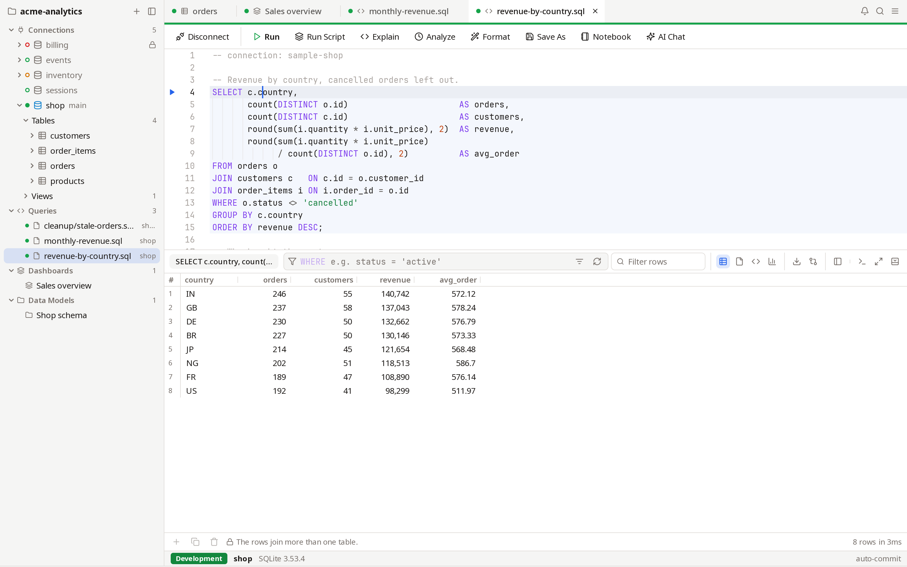

# The window

Keys are written as on macOS; on Linux and Windows, ⌘ is Ctrl and ⌥ is Alt.
[Keyboard shortcuts](../keyboard.md) lists the default keys.

## Title bar and menus

The title bar looks the same on every system and sits beside the system's
window buttons, without a row of its own:

- The sidebar's top row adds a project or a connection, and hides the
  sidebar.
- **Zoom.** ⌘= and ⌘- zoom the whole window, as a browser zooms a page:
  everything larger or smaller, laid out again at that size and as sharp.
  A pinch and ⌘ with the mouse wheel zoom it too. ⌘K ⌘0 puts it back, and
  the zoom is kept for the next start. The sizes of the editors' and the
  grids' text alone are in Settings.
- **Memory.** The sidebar's foot shows the memory DGopher uses, as the
  system's task manager counts it. Click it for the rest: the most it has
  been this run, Go's part and what is outside it (the databases'
  libraries and the drawing), the rows each tab holds, most first, and
  the connections open. **Free Memory** drops what Go no longer needs and
  hands it back to the system; rows a tab still shows stay until the tab
  is closed.
- **The navigator is two panes.** The upper one lists the project's
  files: query files, dashboards and data models. The lower one is the
  tree of the connections and what their databases hold: schemas, tables,
  views, columns. The files come first because the tree is the pane that
  grows as you open tables: the files keep their place, and the tree grows
  into the room below. Each scrolls on its own, and the line between them
  drags. The files are as tall as their rows, so the tree follows them at
  once; when both are long, the files take two fifths of the sidebar
  until you drag the line. CONNECTIONS, the heading over the tree, closes
  all of it, and a heading you leave closed is closed the next time you
  start. With several projects, each pane lists the projects, each with
  its own headings under its row: CONNECTIONS in the tree, QUERIES among
  the files. Dashboards and data models get a heading with the first of
  each, which the sidebar's + and any heading's menu make: a new project
  starts with QUERIES alone. Of the two panes' chosen rows, the one in the
  pane you work in has the full tint and the other a faint one. A
  heading's count is left out when it is zero. A column's type shows by
  its short name, as `varchar` for `character varying`, the whole on
  hover. Unlike DBeaver, whose navigator shows the database tree first and
  keeps scripts in another tab.
- **New SQL Editor asks where.** ⌘T, the palette's command and the + on
  QUERIES open a picker of the connections and the databases known of
  them; the place you are at, the tab in front's connection and database,
  is first and chosen, so ↵ opens another editor there, and typing finds
  any other by name. A server that is not connected lists the databases
  read of it the last time it was; one whose databases were never read
  has a row that connects it to list them, and the picker stays open for
  them. With one place there is nothing to ask. Unlike DBeaver, whose key opens the editor on the current
  connection at once.
- **A database's row has a +**, shown as you point at it or choose it: a
  new SQL editor on that database at once, as its menu's New SQL Editor.
- **A heading does not indent what it holds.** In the tree, CONNECTIONS,
  a connection, and a group of a schema's objects, as TABLES or VIEWS, are
  headings: a connection has its badge and a heavier name, the others are
  in small capitals. The rows under a heading start where it does, so a table's
  name starts two levels sooner. Databases, schemas and tables indent what
  they hold, with a faint line under each one's arrow. Unlike DBeaver,
  whose tree indents every level.
- **The navigator's filter**, under the top row, leaves in both panes the
  connections, tables, files, dashboards and data models whose names hold
  what you type, in any case, opened down to them. A connection or a
  schema that matches shows all it holds. Only what has been read is
  searched: a connection never opened is not connected to be searched. A
  pane without a match gives its room to the other, and when nothing
  matches the navigator says how many connections were not searched. The
  letters that matched are underlined in each name, and a heading counts what
  shows of what it holds, as 2/4. ↵
  opens the match chosen, the first as the panes show them, a file before
  a table, ↓ goes on to its pane, or with nothing typed to the files' under
  the box, Esc clears the filter,
  and the panes are then as open as they were, with the row you chose in
  view. ⌘L focuses it from the navigator.
- **Schemas shown.** A connection with several schemas has **Schemas…** in
  its menu: tick the ones the navigator shows. Its row then says how many,
  as "3 of 12", which opens the same list. The choice is yours alone, kept
  on this computer, not in the project's shared file.
- **Drag a table, a view or a column** from the navigator into an editor
  to write its name there, quoted, at the caret.
- F5, or ⌘R, reads the chosen connection's schema again.
- **New Folder…** for connections is in the sidebar's **+**, in the
  project's own menu and in a connection's. Dragging a connection onto
  the project's name takes it out of its folder.
- **Folders of files.** Queries, Dashboards and Data Models hold folders
  too, as DBeaver's Scripts do: real folders on disk, under `queries/`,
  `dashboards/` and `models/`, nested at will. Folders come first, then
  files. **New Folder…** is in each heading's menu, a folder's and a
  file's (a file moves into the new folder). Drag a file or a folder onto
  another folder, or onto the heading for the top, or use **Move to
  Folder**, which DBeaver lacks, from the keys. F2 renames a folder and
  Delete deletes it with everything in it, once you agree: its tabs close
  and its bookmarks go. A folder's menu makes a new editor, dashboard or
  data model in it. Open tabs follow a file moved or renamed. A
  dashboard's or a data model's name stays unique across folders, for
  **Add to Dashboard** to pick it by name.
- **Sort By** in a heading's menu orders its files by **Name** or by
  **Last Modified**, the latest first; folders stay first, by name. Each
  heading keeps its own order, on this computer. DBeaver has no such sort.
- **Bookmarks**, as DBeaver's: ⌘⌥⇧D, or **Add Bookmark** in a row's menu,
  bookmarks a table, a view, a routine, a query file, a dashboard or a
  data model, and again removes it. Bookmarks are listed under their own
  heading at the top of the files pane, each with where it is; ↵ opens
  one, connecting first. They are kept in the project's
  [`bookmarks.json`](../project-files.md#bookmarksjson), shared with the
  team. Unlike DBeaver, a bookmark is made at once, named after what it
  links to (F2 renames it), files have them too, and they have no folders.
  A bookmark whose file or table is gone shows in the warning color.
- The tab row shows the sidebar again, and holds the
  [notifications](#notifications) bell, the palette's search box and the
  app menu: File, View, Help, Settings and Quit.
- Both rows drag the window. On macOS the system menu bar is kept too.
- **What's New.** The first start after an update shows that version's
  notes from the changelog, once; a first install and the start that
  offers the tour do not. **What's New in DGopher**, in the Help menu or
  the palette, shows them again.

## Command palette

- **⇧⌘P** opens the palette: every command, connection, table, dashboard,
  data model and snippet, by name. The current tab's commands come first,
  such as running, explaining, formatting, committing or rolling back in an
  editor, or refreshing, exporting, fetching, charting and applying rows.
  Each command shows its key.
- **⌘P** opens a table, view, function, procedure or query file by name.
  The tables opened last come first, the latest at the top.

## Tabs

- **Where a tab runs.** Each tab shows its connection: a dot per
  connection in its color (up to three, then a count), filled while
  connected, a ring while not, and a warning when one failed. When two
  tabs share a title, each shows its connection under it, and the database
  when it is not the connection's own. The tooltip lists every connection
  and its state.
- **Reorder** by dragging a tab along the bar. The middle button closes it.
- **Pin** a tab from its menu. A pinned tab moves to the front and shows a
  pin instead of its close button (click the pin to unpin). Close Others,
  Close to the Right, Close All, ⌘W and the middle button leave it open;
  only its menu's Close closes it. Pins survive a restart.
- **Close several** with Close Others, Close to the Right or Close All. The
  app asks once about everything they would lose, with Commit for open
  transactions.
- **Reopen Closed Tab** (⇧⌘T) reopens the last closed tabs, newest first, up
  to 20: editors by their file, tables at their page, diagrams, dashboards
  and models. A tab whose file or connection is gone says so.
- **Overflow.** Tabs that do not fit are listed by a button at the end of
  the bar.

## Editor groups


- **Split.** A tab's menu, the palette or ⌘K → (also ⌘\) puts the tab in a
  new group beside the one it was in; ⌘K ←, ⌘K ↑ and ⌘K ↓ split the other
  ways. A SQL editor alone in its group splits into a copy of itself. Groups
  nest: a group split down beside one split right, as far as you like, with
  dividers to drag.
- **Each group has its own tabs,** with a tab bar of its own once there are
  two: its own order, pins, tab in front, overflow list, and buttons that
  split it or close it. With one group, the tabs stay in the title bar;
  with several, the title bar names the focused group's tab in front.
- **The tab in front** carries a line along its top: in the accent color
  in the focused group, which has the keys, and gray in a group beside it. Keys, the window's title, the
  navigator's highlight, the palette's commands, ⌘W, ⌘1…⌘9 and Next Tab
  act on it. A press anywhere in a group, or ⌘K ⌘← … ⌘K ⌘↓ and ⌘K ⌘1…⌘9,
  focuses it.
- **Move a tab** between groups by dragging it to another group's tab bar,
  by dropping it on the zones a group shows while a tab is dragged over
  it (a side splits the group there, the middle joins it), with Move to
  Group in its menu, or with ⌘K ⇧→ and the other arrows, which make the
  group when there is none on that side.
- **Close Group** (⌘K ⌘W) moves its tabs to the group beside it; nothing
  closes. A group goes by itself with its last tab. Join All Groups, in the
  palette, puts every tab in one.
- Groups, the tabs in each, and the one focused come back after a restart.

## Status bar

- **Each group has its own,** under its tab in front, so a split never
  describes another tab than the one above it. It shows the tab's
  connection, with its database, and its environment in the environment's
  own color; the server and its version, read-only, SSH, the editor's
  transaction and its commit mode. As a group narrows, the server's
  version gives way first. With no tab open, the welcome page has one for
  the connection chosen in the navigator.
- For a tab on several connections, such as a dashboard, it shows a chip
  per connection, problems first, up to three and then "+N more". Each chip
  lists its databases (and the dashboard's panels on them) and connects,
  retries or disconnects its connection.
- **The title bar** keeps what is the window's: every open transaction and
  how long it has been open, and the first of two keys pressed in a row.
- **Activity.** Once any work (a query, reading rows, a count, an export,
  connecting…) has lasted 300 ms, a thin bar moves along the window's
  bottom edge. Quick work shows nothing. Long work offers Stop or Cancel
  where it runs: Fetch All, Count and applying grid changes in the data
  view, and connecting in the tab's status bar, the navigator's menu and a
  restored tab. A cancelled connect is audited, and one that finishes late
  is closed.

## More windows

- A tab's **Move to New Window** puts it in a window of its own, titled by
  its tab in front, beside the main window's sidebar. Dragging a tab out
  past the window's edge does the same, the new window opening where it
  was let go.
- Tabs move between windows. Opening a tab that is already open brings it
  forward in its window.
- Dialogs show in the window you are using.
- Closing a window moves its tabs back to the main window, so nothing in
  them is lost, such as an open transaction. The workspace reopens them all
  there.
- Closing the last tab leaves the start page.
- On macOS, closing the window keeps DGopher running with its tabs and
  connections; the Dock icon shows it again.

## Restart

The tabs come back in their order, with the same one in front: editors,
dashboards and models, and a connection's tables at their page, with
their filter, sort and chosen cell (scrolled into view), ER diagrams, Redis
keys, activity, users and search tabs.

- A connection's tab waits, unconnected, until its connection connects: on
  its own when it comes into view if the connection auto-connects, or when
  you press Connect or ↵. If it fails, the tab's bar says why, with Retry,
  without an alert over it.
- Opening the same table meanwhile takes the waiting tab's place, without
  the kept filter, sort and cell.
- A kept filter the table no longer accepts stays in the WHERE box; the tab
  says why it read no rows, with Edit Filter and Clear Filter.
- The window's size and position are restored.

## Errors

- **An error says what most likely went wrong.** Connecting errors the app
  recognizes (a rejected password, an unknown database, nothing listening,
  a host not found, a timeout, a TLS or SSH problem, a keychain it could
  not read) come with a short hint. The full text is always one click
  away, under **Details**, with **Copy**.
- **The fix is beside it:** Retry or Edit Connection for a connection that
  failed, Reconnect for one that was lost, Refresh for part of the
  navigator that could not be read.
- **What you do that fails tells you at once,** in a dialog: a connect you
  asked for (from the navigator, an editor, a waiting tab's Connect or a
  dashboard's refresh), a lost SSH tunnel, and part of the navigator you
  opened that could not be read. What the app does on its own, as a
  restored tab connecting at start, says so in place and in the
  [notifications](#notifications) instead.
- **Errors wait their turn.** One raised while another is shown waits
  behind it, and the first says "1 of 2". The same error is shown once.
- **Every error is a key away.** **Show Latest Error** (⌘K ⌘E) shows the
  newest again, and **Notifications** (⌘⇧N) lists them all.
- In the navigator, a failed connection shows a red mark, and a part of
  its tree that could not be read a red row. Choosing either, with the
  arrow keys and Enter or a click, shows the error with its fix. Inside a
  tab, the failure is said once, in words, where you connect: an editor's
  toolbar says why beside **Retry** and **Details**. A failed chip of a tab
  on several connections has **Show Error**.
- A table's Structure says "Couldn't read indexes" or "Couldn't read
  foreign keys" when a read failed, rather than none.

## Notifications

The bell in the tab row, or ⌘⇧N, lists this session's notifications,
newest first: every error, every brief message at the bottom of the
window, and the app's own [log messages](../command-line.md#logs). A number
on the bell counts the errors you have not seen; opening the list clears
it. Clicking a notification, or choosing it with the arrow keys and
Enter, shows its full text and its fix; Esc closes the list. The list
keeps the newest 200 and is empty again at the next start; **Clear All**
empties it.

A statement, script, export or import that took 10 seconds or more tells
the system when it ends, if DGopher is in the background. The notice says
what ran, on which connection, and its first error, but never its SQL.
Clicking it brings its tab forward. The time is a setting (0 turns
notifications off).

## Settings and themes

Settings (⌘,) has five pages:

| Page | Settings |
| --- | --- |
| Appearance | theme; editor and interface fonts; editor font size (9–24, 13 by default), which ⌘= and ⌘- in the editor, ⌘K ⌘0, ⌘ with the mouse wheel and pinching a touchpad change too |
| Editor | where statements end; what a script does on an error; Vim; keyboard shortcuts |
| Results | rows per page (50–10,000, 500 by default); when to notify (0–3,600 seconds, 10 by default) |
| Safety | the large-change limit (1,000 rows by default); showing sensitive values |
| Storage | where the app keeps its files, whether a keychain is available, and Show in Folder |

### Keyboard shortcuts

**Customize Keyboard Shortcuts…** (in Settings, the Help menu or the
palette) records a key for any action, or two keys in a row, removes one,
or resets it; each action shows its name, as `editor::Format`. F1 lists
every shortcut as currently set, and finds one by its key or what it does.

- A key that types needs ⌘, Ctrl or Alt, also as the second of two, and a
  key that moves in lists needs a modifier as the first.
- A key another action has where both work is refused, naming that action;
  so is the first of two keys that is another's key on its own, and the
  grid's F2.
- An editor's actions and its results' actions may share a key, as ⌘S and
  F5 do.
- The keys are kept in `keymap.json`, as Zed keeps them: contexts, keys in
  a row, actions by name, and `null` to take a key away. It is read again
  as soon as it changes on disk. See
  [Your keymap file](../keyboard.md#your-keymap-file).

### Themes

Appearance follows the system, or is light, dark, or a named theme. A named
theme shows as chosen even if the system stays dark, as on Linux. Nord,
Dracula and Solarized Light come with the app. The light and dark
appearances keep text at 4.5 to 1 against its background (WCAG AA); the
named themes keep their published colors.



To add a theme, put a JSON file in the themes folder (**Themes Folder**
opens it). A theme with a built-in theme's name replaces it. A theme is
based on light or dark, and sets any of the app's colors by name, as
`#rrggbb` or `#rrggbbaa`:

```json
{"name": "Night Shift", "base": "dark",
 "colors": {"accent": "#f59e0b", "editor": "#101010", "keyword": "#fbbf24"}}
```

| Group | Color names |
| --- | --- |
| Interface | `background`, `surface`, `surfaceHover`, `surfacePressed`, `border`, `text`, `textMuted`, `accent`, `accentText`, `danger`, `warning`, `success`, `selection`, `focus`, `sidebar` |
| Editor | `editor`, `lineNumber`, `currentStatement` |
| Grid | `gridHeader`, `gridLine`, `cellSelected`, `null`, `modified`, `inserted`, `deleted`, `muted`, `hover` |
| SQL | `keyword`, `string`, `number`, `comment`, `quotedIdentifier`, `parameter`, `operator` |

A file that cannot be read is skipped and logged. `gutter`, used by older
versions, is still accepted and has no effect: the gutter takes the
editor's color.

## Accessibility

- Every control has a name that screen readers read. A test fails if one
  lacks a name.
- Charts and the ER diagram describe what they show.
- The end of a run is announced with its result.
- Everything works from the keyboard: Tab moves between controls; the
  navigator, tabs and grids have their own keys; ⇧F10 or the menu key opens
  the context menu of what has focus; and the ER diagram's changes are
  available through the navigator's menus and the table form.
- Dialogs put the focus in their first field. ⌘↵ presses a dialog's main
  button from any field, and Esc closes it. A button that changes data or
  trusts a server (rolling back, dropping, deleting keys, importing,
  copying, restoring, running a file) needs a click.
- Esc, or a click outside, on a form you changed (a connection, the query
  builder, a user, a value…) asks "Discard your changes?" first. A form left
  as it opened closes at once. A dialog whose work is running, such as a
  copy, a backup, an import or Test Connection, stays open; its own Stop or
  Cancel ends the work.
